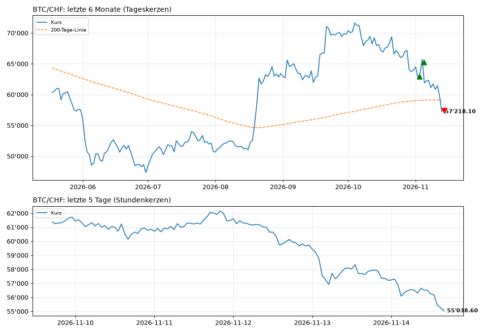
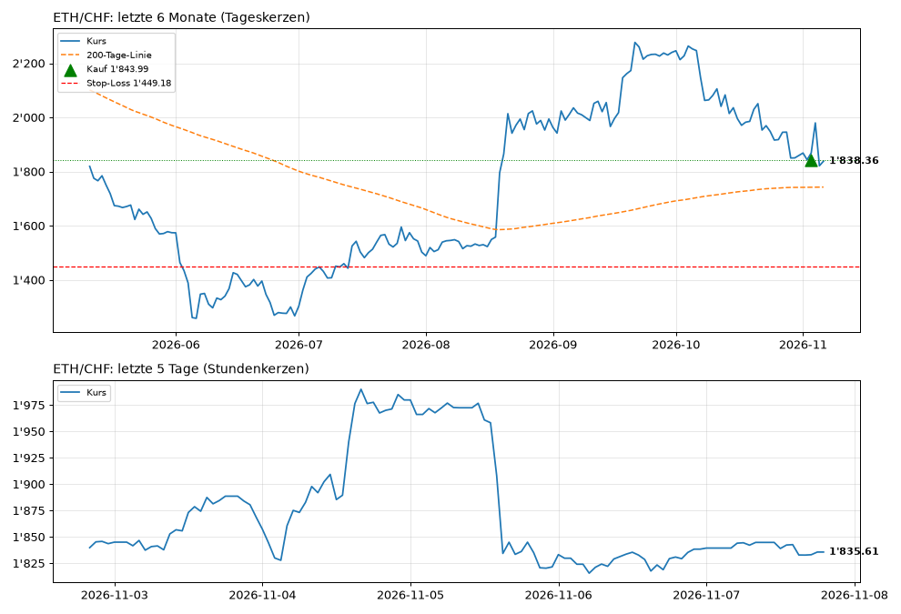
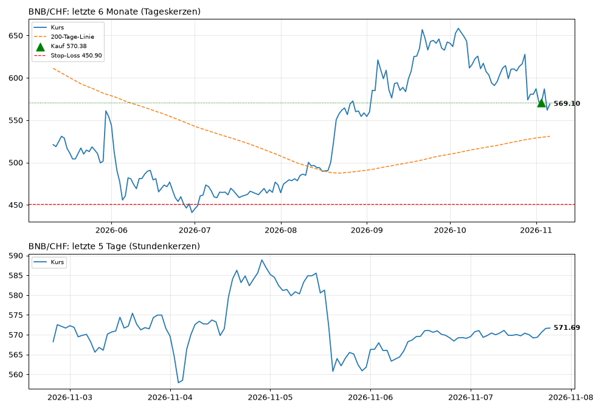
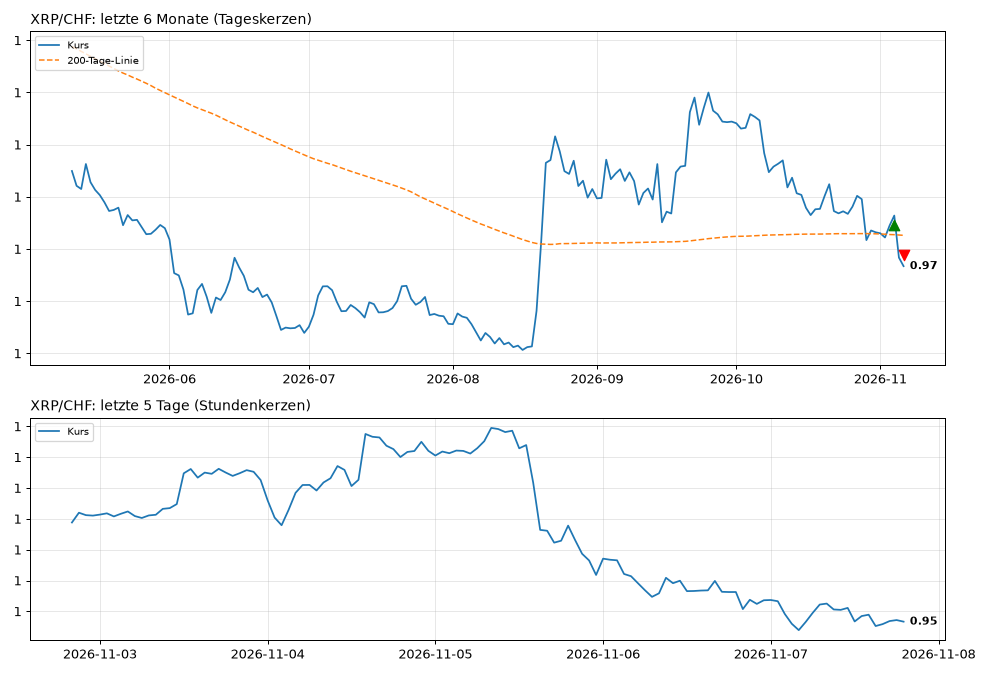
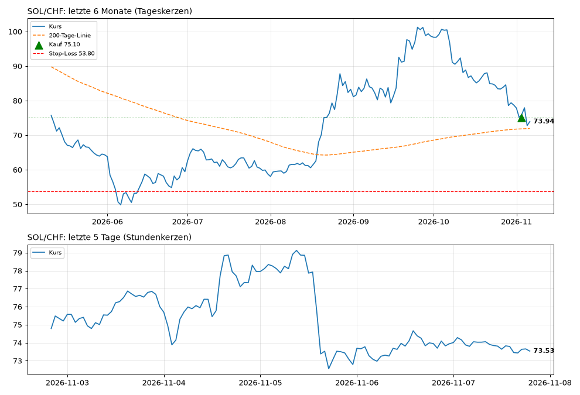
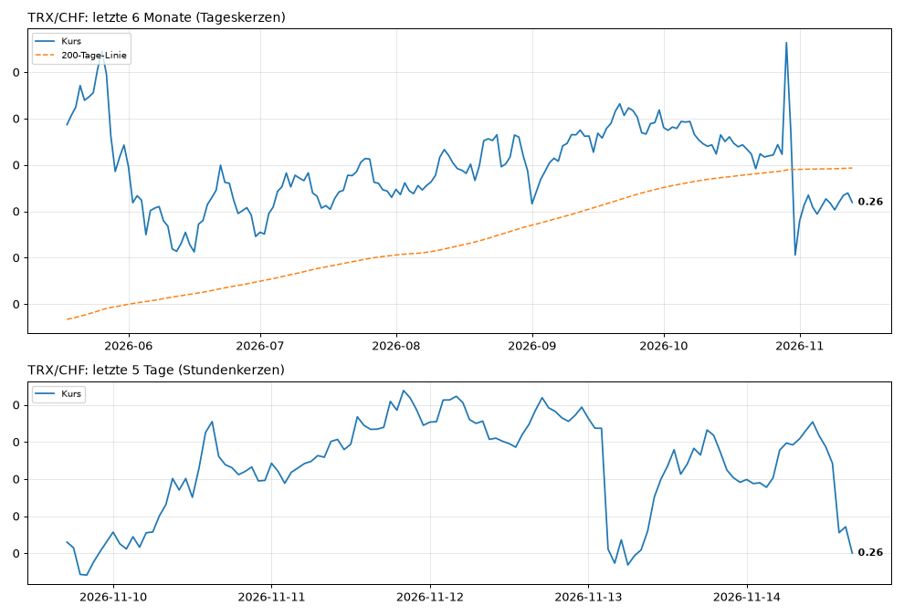
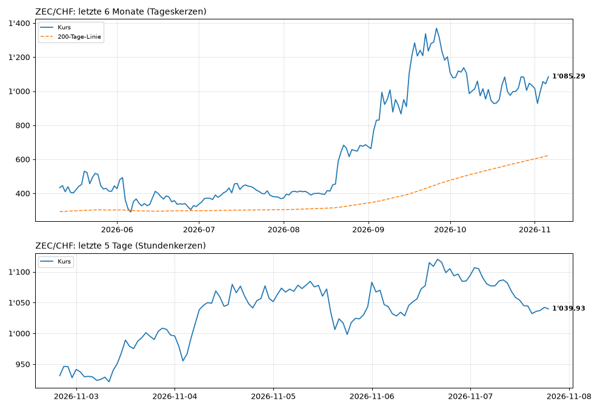
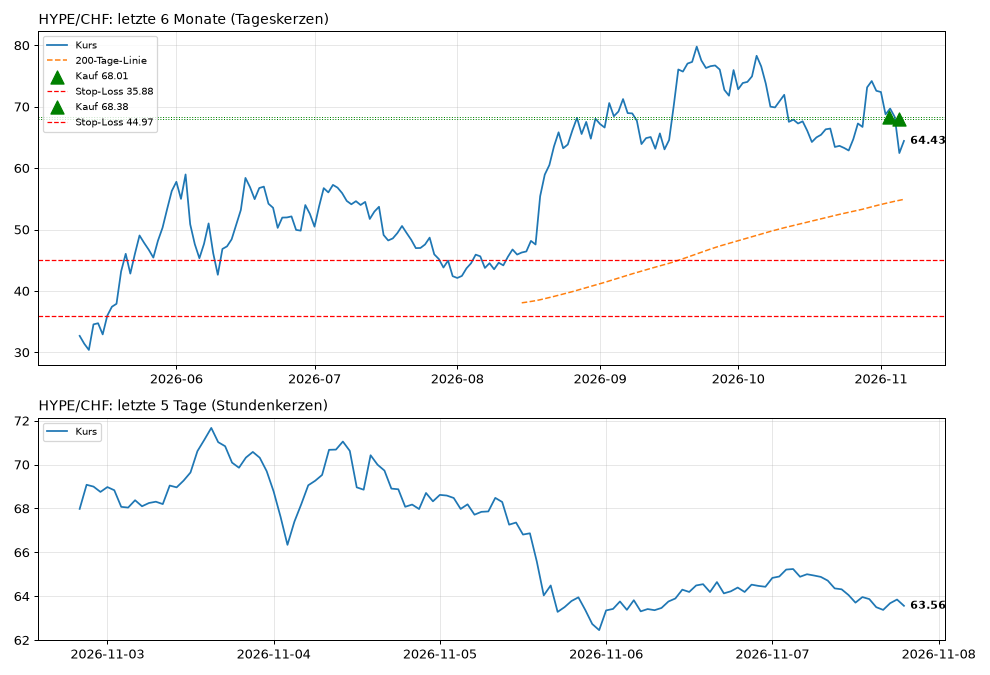

# 📈 Trading-Bot: Übersicht (Demo mit Spielgeld)

Stand: **02.11.2026 05:34** Schweizer Zeit · wird jede Stunde automatisch aktualisiert

> 🖥️ **[Zur Trading-Oberfläche](https://kaidovalue.github.io/trading-bot/)** (übersichtlich, mit Live-Chart)

## Auf einen Blick

- **1️⃣ Langfrist-Bot (Hauptbot):** Schwerpunkt langfristig (200-Tage-Linie, Wochen bis Monate), handelt auch mittelfristig (4h) und kurzfristig (1h), nur in Trendrichtung. Bis 100 % investiert, je Coin bis 20 %. Simulation 2011-2022: +58 %/Jahr, 2023-2026: +40 %/Jahr.
- **2️⃣ KI-Bot (lernend, kurz bis lang):** Lernende KI mit Gedächtnis: merkt sich für jede Marktphase, welche Strategie funktioniert, und vergisst nichts. Nutzt zusätzlich selbst erfundene Strategien aus dem Strategie-Labor. Handelt auf drei Horizonten (1h Daytrading, 4h, Tageskerzen) mit je eigenem Gedächtnis, nur in Trendrichtung. Simulation 2011-2022: +18 %/Jahr, 2023-2026: +14 %/Jahr.
- **3️⃣ Risiko-Bot (aggressiv, Hebel 3×):** Risikofreudig mit Hebel 3×: 200-Tage-Linie (lang) und Trendfolge (4h), nur in Trendrichtung; Daytrading (30-Min.-Ausbrüche) seit 29.10. pausiert, weil es 64 % verlor. Simulation 2011-2022: +66 %/Jahr, 2023-2026: +59 %/Jahr, Rückgänge bis −62 %, 5 % Risiko pro Trade, Hebel 3× mit Zinsen und Zwangsschliessung wie an der Börse, ignoriert Nachrichten.
- **4️⃣ Chef-Bot:** verteilt eigene 1'000 CHF selbstständig auf die drei Stile oben, je nachdem, was in der aktuellen Marktphase am besten läuft.

| | **1️⃣ Langfrist-Bot (Hauptbot)** | **2️⃣ KI-Bot (lernend, kurz bis lang)** | **3️⃣ Risiko-Bot (aggressiv, Hebel 3×)** |
|---|---|---|---|
| Startkapital | 1'000.00 CHF | 1'000.00 CHF | 1'000.00 CHF |
| **Kapital jetzt** | **967.88 CHF** | **922.04 CHF** | **338.77 CHF** |
| Gewinn / Verlust | 🔴 -32.12 CHF (-3.21 %) | 🔴 -77.96 CHF (-7.80 %) | 🔴 -661.23 CHF (-66.12 %) |
| Im Einsatz (investiert) | 441.83 CHF (46 %) | 0.00 CHF (0 %) | 408.97 CHF (121 %) |
| Cash (nicht investiert) | 526.04 CHF | 922.04 CHF | -70.20 CHF |
| Offene Positionen | 6 | 0 | 6 |
| Abgeschlossene Trades | 3 | 24 | 183 |
| Gebühren bisher | 4.40 CHF | 44.26 CHF | 561.19 CHF |
| Gebührenstufe | Stufe 1: 0.80 % je Market-Order (30-Tage-Umsatz 870 CHF) | Stufe 3: 0.38 % je Market-Order (30-Tage-Umsatz 10'817 CHF) | Stufe 6: 0.25 % je Market-Order (30-Tage-Umsatz 129'360 CHF) |
| Horizonte (Strategie, Kerzen) | lang: regime 1d · mittel: buch_triple_screen 4h · kurz: adaptive 1h | kurz: adaptive_memory 1h · mittel: adaptive_memory 4h · lang: adaptive_memory 1d | mittel: trend 4h · lang: regime 1d |
| Kapitalanteil je Horizont | lang 48 % · mittel 26 % · kurz 26 % | kurz 24 % · mittel 35 % · lang 41 % | mittel 67 % · lang 33 % |
| Short erlaubt | nein | nein | nein |
| Hebel | ohne | ohne | 3× (Zinsen bisher 9.40 CHF) |
| Hebel aktuell | – | – | 1.21× (erlaubt 3×) |
| Buchhaltung | ✅ stimmt (Abweichung 0.00 CHF) · Altlasten vor 28.10.: 0.01 CHF | ✅ stimmt (Abweichung 0.00 CHF) · Altlasten vor 28.10.: 0.04 CHF | ✅ stimmt (Abweichung 0.00 CHF) · Altlasten vor 28.10.: 8.50 CHF |
| Letzter Durchlauf | 02.11.2026 05:32 (vor 2 Min.) | 02.11.2026 05:33 (vor 1 Min.) | 02.11.2026 05:34 (gerade eben) |

## 4️⃣ Chef-Bot (verteilt auf die drei Stile)

Er handelt nicht selbst, sondern legt sein eigenes Kapital anteilig in die Stile der drei anderen Bots an und schichtet um, wenn ein Stil in der aktuellen Marktphase besser läuft. Feste Grenzen: höchstens 20 % im Risiko-Stil (Hebel), Notbremse bei mehr als 3 % Verlust eines Stils in 3 Stunden.

| | |
|---|---|
| Startkapital | 1'000.00 CHF |
| **Kapital jetzt** | **950.39 CHF** |
| Gewinn / Verlust | 🔴 -49.61 CHF (-4.96 %) |
| **Aktuelle Verteilung** | Langfrist 25 % · KI 17 % · Risiko 3 % · Cash 55 % |
| Marktphase (BTC, Tageskerzen) | Aufwärtstrend, ruhig |
| Letzte Begründung | Marktphase «Aufwärtstrend, ruhig», Einschätzung: Langfrist -1.6 %, KI -4.2 %, Risiko -67.4 % |
| Umschicht-Gebühren bisher | 5.11 CHF |
| Erfahrung im Gedächtnis | 484 Läufe |

**Was das Gedächtnis in dieser Phase weiss:** Langfrist -0.002 %/Lauf, KI -0.015 %/Lauf, Risiko -0.304 %/Lauf

## Kurse

| Coin | Kurs jetzt | 24 Std. | Live-Chart |
|---|---|---|---|
| **BTC** | 64'700.00 CHF | 🟢 +0.18 % | [öffnen](https://www.tradingview.com/chart/?symbol=KRAKEN:BTCCHF) |
| **ETH** | 1'900.25 CHF | 🟢 +1.18 % | [öffnen](https://www.tradingview.com/chart/?symbol=KRAKEN:ETHCHF) |
| **BNB** | 587.20 CHF | 🟢 +0.06 % | [öffnen](https://www.tradingview.com/chart/?symbol=KRAKEN:BNBUSD) |
| **XRP** | 1.04 CHF | 🟢 +0.56 % | [öffnen](https://www.tradingview.com/chart/?symbol=KRAKEN:XRPUSD) |
| **SOL** | 78.53 CHF | 🟢 +0.92 % | [öffnen](https://www.tradingview.com/chart/?symbol=KRAKEN:SOLUSD) |
| **TRX** | 0.26 CHF | 🟢 +0.36 % | [öffnen](https://www.tradingview.com/chart/?symbol=KRAKEN:TRXUSD) |
| **ZEC** | 1'054.41 CHF | 🟢 +3.72 % | [öffnen](https://www.tradingview.com/chart/?symbol=KRAKEN:ZECUSD) |
| **HYPE** | 72.80 CHF | 🟢 +0.64 % | [öffnen](https://www.tradingview.com/chart/?symbol=KRAKEN:HYPEUSD) |

## 1️⃣ Langfrist-Bot (Hauptbot)

_Schwerpunkt langfristig (200-Tage-Linie, Wochen bis Monate), handelt auch mittelfristig (4h) und kurzfristig (1h), nur in Trendrichtung. Bis 100 % investiert, je Coin bis 20 %. Simulation 2011-2022: +58 %/Jahr, 2023-2026: +40 %/Jahr._

**Offene Positionen**

| Coin | Gekauft am | Einstiegskurs | Kurs jetzt | Menge | Einsatz | Wert jetzt | Gewinn / Verlust | Stop-Loss |
|---|---|---|---|---|---|---|---|---|
| **BTC** long (lang) | 23.10.2026 18:09 | 67'388.78 | 64'700.00 | 0.001485 | 100.05 CHF | 96.06 CHF | 🔴 -3.99 CHF (-3.99 %) | 53'251.84 (-18 %) |
| **ETH** long (lang) | 23.10.2026 18:09 | 1'986.19 | 1'900.25 | 0.040710 | 80.86 CHF | 77.36 CHF | 🔴 -3.50 CHF (-4.33 %) | 1'371.11 (-28 %) |
| **BNB** long (lang) | 23.10.2026 19:15 | 617.14 | 587.20 | 0.162070 | 100.02 CHF | 95.17 CHF | 🔴 -4.85 CHF (-4.85 %) | 483.48 (-18 %) |
| **XRP** long (lang) | 23.10.2026 19:15 | 1.08 | 1.04 | 58.690975 | 63.53 CHF | 60.77 CHF | 🔴 -2.76 CHF (-4.34 %) | 0.66 (-37 %) |
| **SOL** long (lang) | 23.10.2026 19:15 | 86.38 | 78.53 | 0.797780 | 68.91 CHF | 62.65 CHF | 🔴 -6.26 CHF (-9.08 %) | 55.00 (-30 %) |
| **ZEC** long (lang) | 01.11.2026 16:31 | 1'021.01 | 1'054.41 | 0.047253 | 48.25 CHF | 49.82 CHF | 🟢 +1.58 CHF (+3.27 %) | 278.44 (-74 %) |

**Signale jetzt**

| Coin | lang (1d) | mittel (4h) | kurz (1h) |
|---|---|---|---|
| BTC | 🟢 investiert sein | 🔴 raus / Cash | 🟢 investiert sein |
| ETH | 🟢 investiert sein | 🔴 raus / Cash | ⚪ neutral |
| BNB | 🟢 investiert sein | 🔴 raus / Cash | 🟢 investiert sein |
| XRP | ⚪ neutral | 🔴 raus / Cash | 🔴 raus / Cash |
| SOL | 🟢 investiert sein | 🔴 raus / Cash | 🟢 investiert sein |
| TRX | 🔴 raus / Cash | 🔴 raus / Cash | 🔴 raus / Cash |
| ZEC | 🟢 investiert sein | ⚪ neutral | 🔴 raus / Cash |
| HYPE | 🟢 investiert sein | ⚪ neutral | ⚪ neutral |

**Letzte Entscheidung:** [lang] BTC/CHF: Position offen, Signal bestätigt · [lang] ETH/CHF: Position offen, Signal bestätigt · [lang] BNB/CHF: Position offen, Signal bestätigt · [lang] XRP/CHF: kein Signal · [lang] SOL/CHF: Position offen, Signal bestätigt · [lang] TRX/CHF: Signal 'raus', bleibe in Cash · [lang] ZEC/CHF: Position offen, Signal bestätigt · [lang] HYPE/CHF: Einstieg pausiert wegen Nachrichtenlage (bestätigte Themen: hack, Wert -1.0) · [mittel] BTC/CHF: Position gehört zum Horizont «lang» · [mittel] ETH/CHF: Position gehört zum Horizont «lang» · [mittel] BNB/CHF: Position gehört zum Horizont «lang» · [mittel] XRP/CHF: Position gehört zum Horizont «lang» · [mittel] SOL/CHF: Position gehört zum Horizont «lang» · [mittel] TRX/CHF: Signal 'raus', bleibe in Cash · [mittel] ZEC/CHF: kein Signal · [mittel] HYPE/CHF: kein Signal · [kurz] BTC/CHF: Position gehört zum Horizont «lang» · [kurz] ETH/CHF: kein Signal · [kurz] BNB/CHF: Position gehört zum Horizont «lang» · [kurz] XRP/CHF: Position gehört zum Horizont «lang» · [kurz] SOL/CHF: Position gehört zum Horizont «lang» · [kurz] TRX/CHF: Signal 'raus', bleibe in Cash · [kurz] ZEC/CHF: Position gehört zum Horizont «lang» · [kurz] HYPE/CHF: kein Signal

**Letzte abgeschlossene Trades**

| Coin | Gekauft | Verkauft | Einstieg | Ausstieg | Ergebnis | Grund |
|---|---|---|---|---|---|---|
| TRX long (lang) | 29.10.2026 18:11 | 31.10.2026 23:28 | 0.27 | 0.25 | 🔴 -8.69 CHF | Stop-Loss |
| ZEC short (kurz) | 28.10.2026 20:17 | 28.10.2026 22:22 | 1'064.43 | 1'082.08 | 🔴 -0.67 CHF | Vorrang lang |
| TRX short (kurz) | 28.10.2026 20:17 | 28.10.2026 22:22 | 0.27 | 0.27 | 🔴 -0.90 CHF | Vorrang lang |

## 2️⃣ KI-Bot (lernend, kurz bis lang)

_Lernende KI mit Gedächtnis: merkt sich für jede Marktphase, welche Strategie funktioniert, und vergisst nichts. Nutzt zusätzlich selbst erfundene Strategien aus dem Strategie-Labor. Handelt auf drei Horizonten (1h Daytrading, 4h, Tageskerzen) mit je eigenem Gedächtnis, nur in Trendrichtung. Simulation 2011-2022: +18 %/Jahr, 2023-2026: +14 %/Jahr._

Keine offene Position, alles in Cash.

**Signale jetzt**

| Coin | kurz (1h) | mittel (4h) | lang (1d) |
|---|---|---|---|
| BTC | 🟢 investiert sein | ⚪ neutral | ⚪ neutral |
| ETH | 🟢 investiert sein | 🔴 raus / Cash | 🔴 raus / Cash |
| BNB | 🟢 investiert sein | ⚪ neutral | ⚪ neutral |
| XRP | ⚪ neutral | 🔴 raus / Cash | 🔴 raus / Cash |
| SOL | 🔴 raus / Cash | 🟢 investiert sein | ⚪ neutral |
| TRX | 🔴 raus / Cash | 🟢 investiert sein | ⚪ neutral |
| ZEC | ⚪ neutral | 🟢 investiert sein | ⚪ neutral |
| HYPE | 🔴 raus / Cash | 🟢 investiert sein | 🟢 investiert sein |

**🧠 KI-Gedächtnis:** 21'718 Kerzen Erfahrung (wächst bei jedem Lauf)

| Coin | Marktphase jetzt | Hier vertraut die KI am meisten |
|---|---|---|
| BTC | Seitwärts, ruhig | labor_5 (+0.095 %/Kerze), mean_reversion (+0.015 %/Kerze), labor_3 (+0.004 %/Kerze) |
| ETH | Aufwärtstrend, ruhig | labor_5 (+0.821 %/Kerze), trend (+0.060 %/Kerze), reversal (+0.028 %/Kerze) |
| BNB | Seitwärts, ruhig | labor_5 (+0.095 %/Kerze), mean_reversion (+0.015 %/Kerze), labor_3 (+0.004 %/Kerze) |
| XRP | Seitwärts, ruhig | labor_5 (+0.095 %/Kerze), mean_reversion (+0.015 %/Kerze), labor_3 (+0.004 %/Kerze) |
| SOL | Abwärtstrend, ruhig | trend (-0.009 %/Kerze), pullback (-0.009 %/Kerze), labor_4 (-0.010 %/Kerze) |
| TRX | Abwärtstrend, ruhig | trend (-0.009 %/Kerze), pullback (-0.009 %/Kerze), labor_4 (-0.010 %/Kerze) |
| ZEC | Aufwärtstrend, ruhig | labor_5 (+0.821 %/Kerze), trend (+0.060 %/Kerze), reversal (+0.028 %/Kerze) |
| HYPE | Seitwärts, ruhig | labor_5 (+0.095 %/Kerze), mean_reversion (+0.015 %/Kerze), labor_3 (+0.004 %/Kerze) |

**🧪 Selbst erfundene Strategien im Einsatz:** 5 (labor_3, labor_4, labor_2, labor_1, labor_5), Details in [lernen/LABOR.md](lernen/LABOR.md)

**Letzte Entscheidung:** [kurz] BTC/CHF: kein Einstieg (erwartete Bewegung zu klein für die Gebühren) · [kurz] ETH/CHF: kein Einstieg (erwartete Bewegung zu klein für die Gebühren) · [kurz] BNB/CHF: kein Einstieg (erwartete Bewegung zu klein für die Gebühren) · [kurz] XRP/CHF: kein Signal · [kurz] SOL/CHF: Signal 'raus', bleibe in Cash · [kurz] TRX/CHF: Signal 'raus', bleibe in Cash · [kurz] ZEC/CHF: kein Signal · [kurz] HYPE/CHF: Signal 'raus', bleibe in Cash · [mittel] BTC/CHF: kein Signal · [mittel] ETH/CHF: Signal 'raus', bleibe in Cash · [mittel] BNB/CHF: kein Signal · [mittel] XRP/CHF: Signal 'raus', bleibe in Cash · [mittel] SOL/CHF: kein Einstieg (erwartete Bewegung zu klein für die Gebühren) · [mittel] TRX/CHF: kein Einstieg gegen den langfristigen Trend (200-Tage-Linie) · [mittel] ZEC/CHF: kein Einstieg (erwartete Bewegung zu klein für die Gebühren) · [mittel] HYPE/CHF: kein Einstieg (erwartete Bewegung zu klein für die Gebühren)

**Letzte abgeschlossene Trades**

| Coin | Gekauft | Verkauft | Einstieg | Ausstieg | Ergebnis | Grund |
|---|---|---|---|---|---|---|
| BNB long (lang) | 28.10.2026 16:15 | 30.10.2026 01:20 | 621.75 | 582.59 | 🔴 -17.38 CHF | Signal |
| HYPE short (lang) | 28.10.2026 20:19 | 29.10.2026 18:50 | 66.85 | 77.50 | 🔴 -7.96 CHF | Von Hand geschlossen |
| TRX short (lang) | 28.10.2026 20:19 | 29.10.2026 18:50 | 0.27 | 0.27 | 🔴 -2.62 CHF | Von Hand geschlossen |
| ETH long (mittel) | 28.10.2026 16:15 | 29.10.2026 01:23 | 1'934.17 | 1'953.68 | 🟢 +1.16 CHF | Vorrang lang |
| BTC short (mittel) | 28.10.2026 20:19 | 29.10.2026 01:23 | 67'094.94 | 67'266.32 | 🔴 -1.89 CHF | Vorrang lang |
| XRP short (mittel) | 28.10.2026 20:19 | 28.10.2026 21:18 | 1.10 | 1.10 | 🔴 -0.59 CHF | Signal |
| BNB long | 28.10.2026 13:15 | 28.10.2026 15:45 | 627.36 | 619.66 | 🔴 -5.43 CHF | Stop-Loss (Gap) |
| ETH long | 28.10.2026 13:15 | 28.10.2026 15:45 | 1'946.78 | 1'929.91 | 🔴 -3.33 CHF | Stop-Loss (Gap) |
| BTC long | 27.10.2026 16:00 | 28.10.2026 14:15 | 66'509.84 | 66'883.94 | 🟢 +0.10 CHF | Signal |
| ETH long | 27.10.2026 16:00 | 28.10.2026 09:42 | 1'928.15 | 1'963.28 | 🟢 +3.12 CHF | Take-Profit |

## 3️⃣ Risiko-Bot (aggressiv, Hebel 3×)

_Risikofreudig mit Hebel 3×: 200-Tage-Linie (lang) und Trendfolge (4h), nur in Trendrichtung; Daytrading (30-Min.-Ausbrüche) seit 29.10. pausiert, weil es 64 % verlor. Simulation 2011-2022: +66 %/Jahr, 2023-2026: +59 %/Jahr, Rückgänge bis −62 %, 5 % Risiko pro Trade, Hebel 3× mit Zinsen und Zwangsschliessung wie an der Börse, ignoriert Nachrichten._

**Offene Positionen**

| Coin | Gekauft am | Einstiegskurs | Kurs jetzt | Menge | Einsatz | Wert jetzt | Gewinn / Verlust | Stop-Loss |
|---|---|---|---|---|---|---|---|---|
| **BTC** long (lang) | 29.10.2026 01:24 | 67'266.32 | 64'700.00 | 0.001914 | 128.78 CHF | 123.87 CHF | 🔴 -4.91 CHF (-3.82 %) | 57'602.04 (-11 %) |
| **ETH** long (lang) | 29.10.2026 01:24 | 1'955.64 | 1'900.25 | 0.029964 | 58.60 CHF | 56.94 CHF | 🔴 -1.66 CHF (-2.83 %) | 1'542.64 (-19 %) |
| **BNB** long (lang) | 30.10.2026 01:21 | 568.49 | 587.20 | 0.142673 | 81.11 CHF | 83.78 CHF | 🟢 +2.67 CHF (+3.29 %) | 445.65 (-24 %) |
| **SOL** long (lang) | 30.10.2026 01:21 | 77.50 | 78.53 | 0.783734 | 60.74 CHF | 61.55 CHF | 🟢 +0.81 CHF (+1.33 %) | 55.18 (-30 %) |
| **ZEC** long (lang) | 30.10.2026 01:21 | 992.34 | 1'054.41 | 0.029945 | 29.72 CHF | 31.57 CHF | 🟢 +1.86 CHF (+6.26 %) | 410.56 (-61 %) |
| **HYPE** long (lang) | 30.10.2026 01:21 | 73.47 | 72.80 | 0.704156 | 51.73 CHF | 51.26 CHF | 🔴 -0.47 CHF (-0.91 %) | 48.72 (-33 %) |

**Signale jetzt**

| Coin | mittel (4h) | lang (1d) |
|---|---|---|
| BTC | 🔴 raus / Cash | 🟢 investiert sein |
| ETH | 🔴 raus / Cash | 🟢 investiert sein |
| BNB | 🔴 raus / Cash | 🟢 investiert sein |
| XRP | 🔴 raus / Cash | ⚪ neutral |
| SOL | 🔴 raus / Cash | 🟢 investiert sein |
| TRX | 🔴 raus / Cash | 🔴 raus / Cash |
| ZEC | 🟢 investiert sein | 🟢 investiert sein |
| HYPE | 🟢 investiert sein | 🟢 investiert sein |

**Letzte Entscheidung:** [mittel] BTC/CHF: Position gehört zum Horizont «lang» · [mittel] ETH/CHF: Position gehört zum Horizont «lang» · [mittel] BNB/CHF: Position gehört zum Horizont «lang» · [mittel] XRP/CHF: Signal 'raus', bleibe in Cash · [mittel] SOL/CHF: Position gehört zum Horizont «lang» · [mittel] TRX/CHF: Signal 'raus', bleibe in Cash · [mittel] ZEC/CHF: Position gehört zum Horizont «lang» · [mittel] HYPE/CHF: Position gehört zum Horizont «lang»

**Letzte abgeschlossene Trades**

| Coin | Gekauft | Verkauft | Einstieg | Ausstieg | Ergebnis | Grund |
|---|---|---|---|---|---|---|
| TRX long (lang) | 30.10.2026 01:21 | 31.10.2026 16:40 | 0.30 | 0.26 | 🔴 -18.66 CHF | Stop-Loss |
| TRX long (mittel) | 28.10.2026 20:19 | 29.10.2026 22:17 | 0.27 | 0.28 | 🟢 +0.56 CHF | Take-Profit |
| BNB long (mittel) | 28.10.2026 21:19 | 29.10.2026 12:08 | 623.82 | 624.61 | 🔴 -1.74 CHF | Stop-Loss (Gap) |
| XRP long (mittel) | 28.10.2026 20:19 | 29.10.2026 04:28 | 1.10 | 1.07 | 🔴 -7.63 CHF | Stop-Loss (Gap) |
| HYPE short (lang) | 28.10.2026 20:19 | 29.10.2026 01:24 | 66.92 | 66.77 | 🔴 -1.07 CHF | Signal |
| ZEC short (lang) | 28.10.2026 20:19 | 29.10.2026 01:24 | 1'066.19 | 1'083.41 | 🔴 -1.92 CHF | Signal |
| BTC long (mittel) | 28.10.2026 21:19 | 29.10.2026 01:24 | 67'178.57 | 67'199.08 | 🔴 -0.16 CHF | Signal |
| ETH long (kurz) | 28.10.2026 19:48 | 29.10.2026 01:24 | 1'950.58 | 1'953.68 | 🔴 -0.60 CHF | Signal |
| BTC short (kurz) | 28.10.2026 20:49 | 28.10.2026 21:19 | 67'362.30 | 67'178.57 | 🔴 -0.47 CHF | Signal |
| SOL short (kurz) | 28.10.2026 13:45 | 28.10.2026 20:49 | 84.18 | 85.00 | 🔴 -13.10 CHF | Stop-Loss (Gap) |

## Charts

▲ grün = Kauf, ▼ rot = Verkauf, rote Linie = Stop-Loss, orange = 200-Tage-Linie. Die Bilder zeigen den Stand der letzten Aktualisierung; für den Live-Kurs auf «Live-Chart» klicken.

### BTC/CHF · [Live-Chart](https://www.tradingview.com/chart/?symbol=KRAKEN:BTCCHF)

### ETH/CHF · [Live-Chart](https://www.tradingview.com/chart/?symbol=KRAKEN:ETHCHF)

### BNB/CHF · [Live-Chart](https://www.tradingview.com/chart/?symbol=KRAKEN:BNBUSD)

### XRP/CHF · [Live-Chart](https://www.tradingview.com/chart/?symbol=KRAKEN:XRPUSD)

### SOL/CHF · [Live-Chart](https://www.tradingview.com/chart/?symbol=KRAKEN:SOLUSD)

### TRX/CHF · [Live-Chart](https://www.tradingview.com/chart/?symbol=KRAKEN:TRXUSD)

### ZEC/CHF · [Live-Chart](https://www.tradingview.com/chart/?symbol=KRAKEN:ZECUSD)

### HYPE/CHF · [Live-Chart](https://www.tradingview.com/chart/?symbol=KRAKEN:HYPEUSD)

## Nachrichtenlage

- **Stimmung (Fear & Greed):** 37 von 100, Angst
- **Bewertung News:** -1.00 (−1 sehr negativ bis +1 sehr positiv)
- **Bestätigte Themen:** hack (gemeldet von coindesk, decrypt – blockiert Käufe)

**Schlagzeilen dazu:**

- 2026-11-01 16:01 UTC · **decrypt** · [Bitcoin ETF Investors Head for the Exits After Record Binance Hack](https://decrypt.co/382309/bitcoin-etf-investors-exits-record-binance-hack) _(Thema: hack)_
- 2026-11-01 10:35 UTC · **coindesk** · [Binance opens crypto withdrawals in phases starting with bitcoin following $6.3 billion hack](https://www.coindesk.com/markets/2026/11/01/binance-opens-crypto-withdrawals-in-phases-starting-with-bitcoin-following-usd6-3-billion-hack) _(Thema: hack)_
