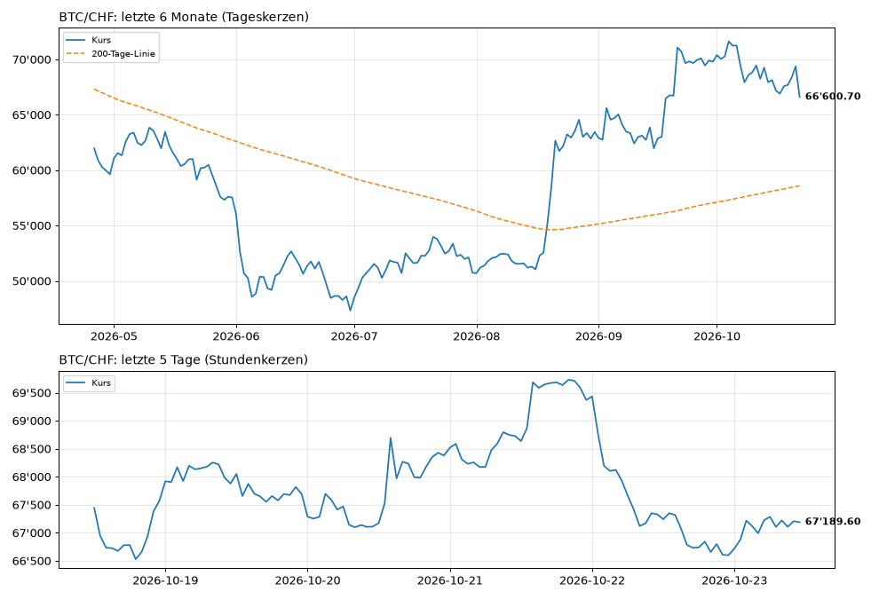
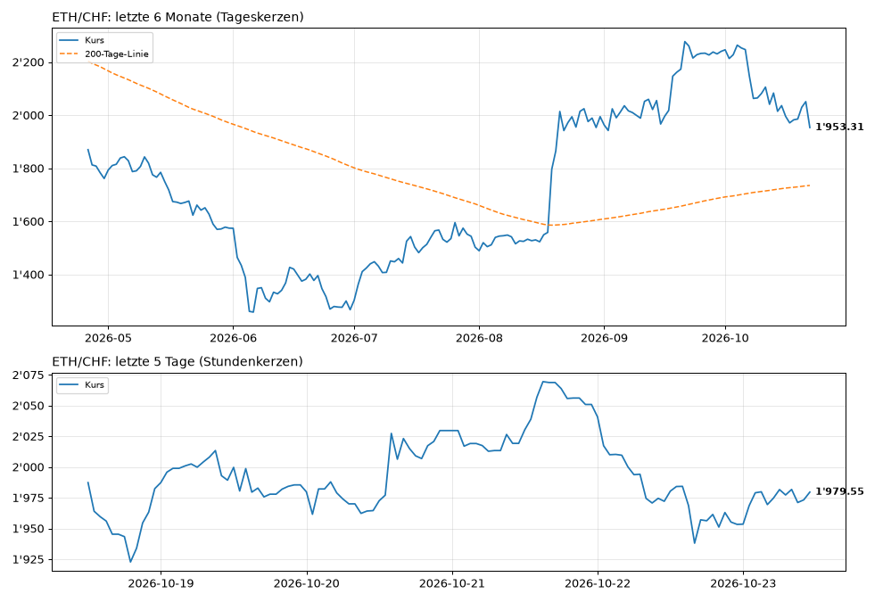
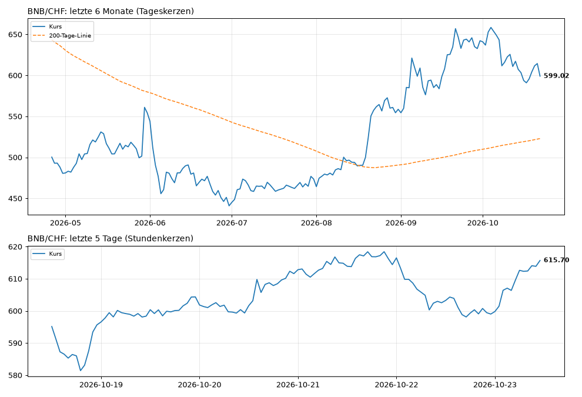
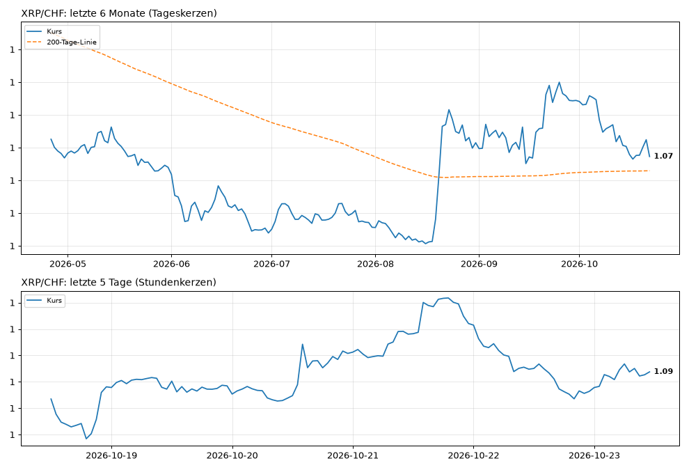
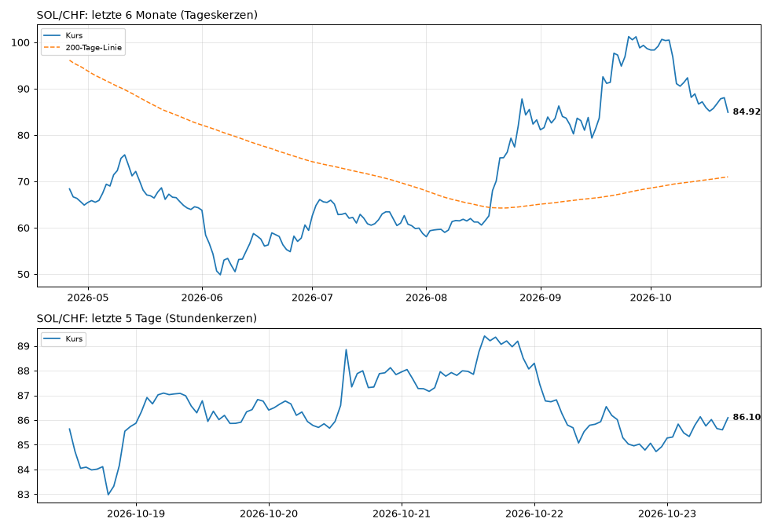
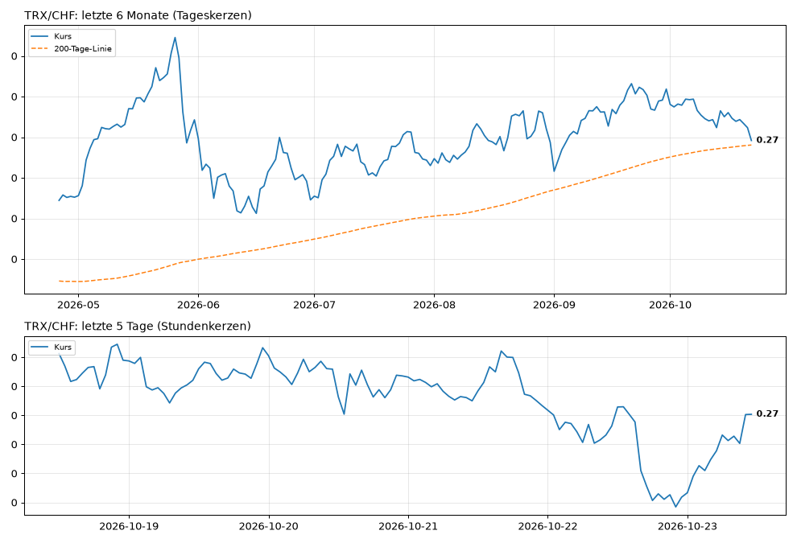
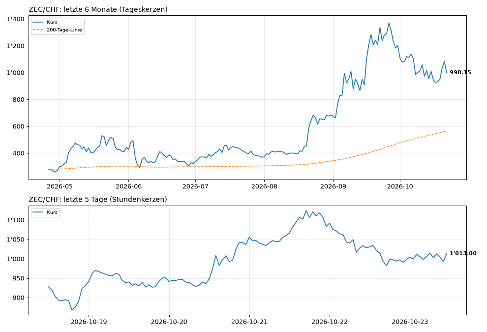
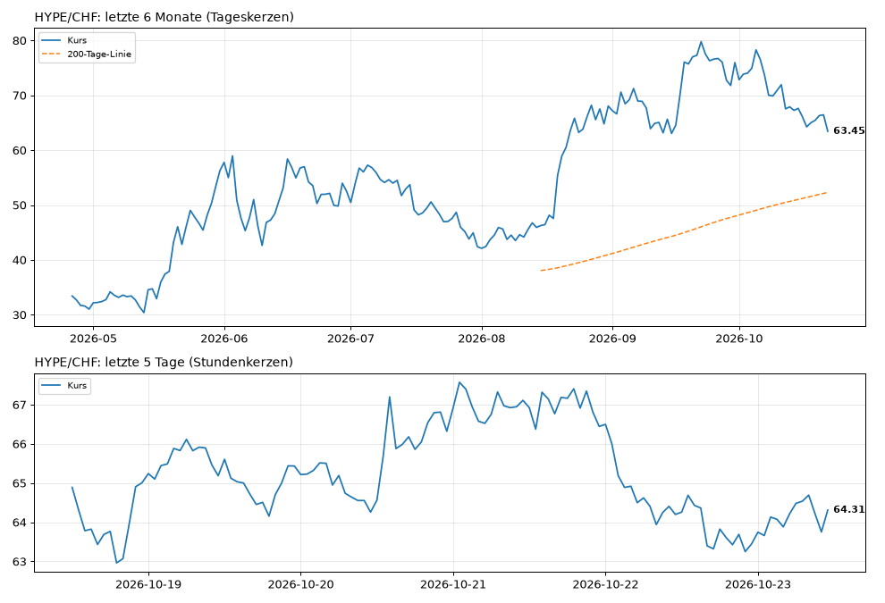

# 📈 Trading-Bot: Übersicht (Demo mit Spielgeld)

Stand: **23.10.2026 14:55** Schweizer Zeit · wird jede Stunde automatisch aktualisiert

## Auf einen Blick

| | **Langfrist-Bot (200-Tage-Regel, Hauptbot)** | **Daytrading-Bot (1-Stunden-Kerzen, Vergleich)** | **Risiko-Bot (30-Minuten-Kerzen, aggressiv, long + short)** |
|---|---|---|---|
| Startkapital | 1'000.00 CHF | 1'000.00 CHF | 1'000.00 CHF |
| **Kapital jetzt** | **1'000.00 CHF** | **1'000.00 CHF** | **1'000.00 CHF** |
| Gewinn / Verlust | ⚪ +0.00 CHF (+0.00 %) | ⚪ +0.00 CHF (+0.00 %) | ⚪ +0.00 CHF (+0.00 %) |
| Im Einsatz (investiert) | 0.00 CHF (0 %) | 0.00 CHF (0 %) | 0.00 CHF (0 %) |
| Cash (nicht investiert) | 1'000.00 CHF | 1'000.00 CHF | 1'000.00 CHF |
| Offene Positionen | 0 | 0 | 0 |
| Abgeschlossene Trades | 0 | 0 | 0 |
| Strategie | regime, 1d-Kerzen | adaptive, 1h-Kerzen | breakout, 30m-Kerzen |

## Kurse

| Coin | Kurs jetzt | 24 Std. | Live-Chart |
|---|---|---|---|
| **BTC** | 67'193.30 CHF | 🟢 +0.83 % | [öffnen](https://www.tradingview.com/chart/?symbol=KRAKEN:BTCCHF) |
| **ETH** | 1'973.65 CHF | 🟢 +1.10 % | [öffnen](https://www.tradingview.com/chart/?symbol=KRAKEN:ETHCHF) |
| **BNB** | 612.55 CHF | 🟢 +1.96 % | [öffnen](https://www.tradingview.com/chart/?symbol=KRAKEN:BNBUSD) |
| **XRP** | 1.08 CHF | 🟢 +0.57 % | [öffnen](https://www.tradingview.com/chart/?symbol=KRAKEN:XRPUSD) |
| **SOL** | 85.75 CHF | 🟢 +0.69 % | [öffnen](https://www.tradingview.com/chart/?symbol=KRAKEN:SOLUSD) |
| **TRX** | 0.27 CHF | 🟢 +0.48 % | [öffnen](https://www.tradingview.com/chart/?symbol=KRAKEN:TRXUSD) |
| **ZEC** | 1'011.39 CHF | 🟢 +0.86 % | [öffnen](https://www.tradingview.com/chart/?symbol=KRAKEN:ZECUSD) |
| **HYPE** | 63.90 CHF | 🟢 +0.44 % | [öffnen](https://www.tradingview.com/chart/?symbol=KRAKEN:HYPEUSD) |

## Langfrist-Bot (200-Tage-Regel, Hauptbot)

Keine offene Position, alles in Cash.

**Signale jetzt**

| Coin | Signal |
|---|---|
| BTC | 🟢 investiert sein |
| ETH | 🟢 investiert sein |
| BNB | 🟢 investiert sein |
| XRP | 🟢 investiert sein |
| SOL | 🟢 investiert sein |
| TRX | ⚪ neutral |
| ZEC | 🟢 investiert sein |
| HYPE | 🟢 investiert sein |

**Letzte Entscheidung:** BTC/CHF: Einstieg pausiert wegen Nachrichtenlage (bestätigte Themen: hack,klage, Wert -1.0) · ETH/CHF: Einstieg pausiert wegen Nachrichtenlage (bestätigte Themen: hack,klage, Wert -1.0) · BNB/CHF: Einstieg pausiert wegen Nachrichtenlage (bestätigte Themen: hack,klage, Wert -1.0) · XRP/CHF: Einstieg pausiert wegen Nachrichtenlage (bestätigte Themen: hack,klage, Wert -1.0) · SOL/CHF: Einstieg pausiert wegen Nachrichtenlage (bestätigte Themen: hack,klage, Wert -1.0) · TRX/CHF: kein Signal · ZEC/CHF: Einstieg pausiert wegen Nachrichtenlage (bestätigte Themen: hack,klage, Wert -1.0) · HYPE/CHF: Einstieg pausiert wegen Nachrichtenlage (bestätigte Themen: hack,klage, Wert -1.0)

## Daytrading-Bot (1-Stunden-Kerzen, Vergleich)

Keine offene Position, alles in Cash.

**Signale jetzt**

| Coin | Signal |
|---|---|
| BTC | 🔴 raus / Cash |
| ETH | 🔴 raus / Cash |
| BNB | ⚪ neutral |
| XRP | 🔴 raus / Cash |
| SOL | 🔴 raus / Cash |
| TRX | 🔴 raus / Cash |
| ZEC | 🔴 raus / Cash |
| HYPE | 🔴 raus / Cash |

**Letzte Entscheidung:** BTC/CHF: Signal 'raus', bleibe in Cash · ETH/CHF: Signal 'raus', bleibe in Cash · BNB/CHF: kein Signal · XRP/CHF: Signal 'raus', bleibe in Cash · SOL/CHF: Signal 'raus', bleibe in Cash · TRX/CHF: Signal 'raus', bleibe in Cash · ZEC/CHF: Signal 'raus', bleibe in Cash · HYPE/CHF: Signal 'raus', bleibe in Cash

## Risiko-Bot (30-Minuten-Kerzen, aggressiv, long + short)

Keine offene Position, alles in Cash.

**Signale jetzt**

| Coin | Signal |
|---|---|
| BTC | ⚪ neutral |
| ETH | ⚪ neutral |
| BNB | ⚪ neutral |
| XRP | ⚪ neutral |
| SOL | ⚪ neutral |
| TRX | ⚪ neutral |
| ZEC | ⚪ neutral |
| HYPE | ⚪ neutral |

**Letzte Entscheidung:** BTC/CHF: kein Signal · ETH/CHF: kein Signal · BNB/CHF: kein Signal · XRP/CHF: kein Signal · SOL/CHF: kein Signal · TRX/CHF: kein Signal · ZEC/CHF: kein Signal · HYPE/CHF: kein Signal

## Charts

▲ grün = Kauf, ▼ rot = Verkauf, rote Linie = Stop-Loss, orange = 200-Tage-Linie. Die Bilder zeigen den Stand der letzten Aktualisierung; für den Live-Kurs auf «Live-Chart» klicken.

### BTC/CHF · [Live-Chart](https://www.tradingview.com/chart/?symbol=KRAKEN:BTCCHF)

### ETH/CHF · [Live-Chart](https://www.tradingview.com/chart/?symbol=KRAKEN:ETHCHF)

### BNB/CHF · [Live-Chart](https://www.tradingview.com/chart/?symbol=KRAKEN:BNBUSD)

### XRP/CHF · [Live-Chart](https://www.tradingview.com/chart/?symbol=KRAKEN:XRPUSD)

### SOL/CHF · [Live-Chart](https://www.tradingview.com/chart/?symbol=KRAKEN:SOLUSD)

### TRX/CHF · [Live-Chart](https://www.tradingview.com/chart/?symbol=KRAKEN:TRXUSD)

### ZEC/CHF · [Live-Chart](https://www.tradingview.com/chart/?symbol=KRAKEN:ZECUSD)

### HYPE/CHF · [Live-Chart](https://www.tradingview.com/chart/?symbol=KRAKEN:HYPEUSD)

## Nachrichtenlage

- **Stimmung (Fear & Greed):** 50 von 100, neutral
- **Bewertung News:** -1.00 (−1 sehr negativ bis +1 sehr positiv)
- **Bestätigte Themen:** hack (gemeldet von bitcoinmagazine, coindesk – blockiert Käufe); klage (gemeldet von bitcoinmagazine, cointelegraph – nur Hinweis, blockiert nicht)

**Schlagzeilen dazu:**

- 2026-10-23 08:02 UTC · **coindesk** · [India's largest exchange denies hack after sleuths pointed to $16 million in suspicious outflows](https://www.coindesk.com/markets/2026/10/23/india-s-largest-exchange-denies-hack-after-blockchain-sleuths-pointed-to-usd16-million-in-suspicious-outflows) _(Thema: hack)_
- 2026-10-22 21:39 UTC · **cointelegraph** · [Circle shareholder sues Trump, World Liberty and Steve Witkoff over crypto deals](https://cointelegraph.com/news/circle-shareholder-lawsuit-donald-trump-world-liberty-financial-steve-witkoff-crypto-corruption?utm_source=rss_feed&utm_medium=rss&utm_campaign=rss_partner_inbound) _(Thema: klage)_
- 2026-10-22 21:23 UTC · **bitcoinmagazine** · [Circle Shareholder Sues Trump, Alleging Unconstitutional Profits From $2B UAE Crypto Deals](https://bitcoinmagazine.com/news/trump-sued-for-alleged-crypto-corruption) _(Thema: klage)_
- 2026-10-22 13:33 UTC · **bitcoinmagazine** · [SpaceX-Tesla Merger: Passive Flows ‘Hack’, Could Bring More BTC Exposure to S&P 500](https://bitcoinmagazine.com/videos/spacex-tesla-merger-passive-flows-hack-could-bring-more-btc-exposure-to-sp-500) _(Thema: hack)_
