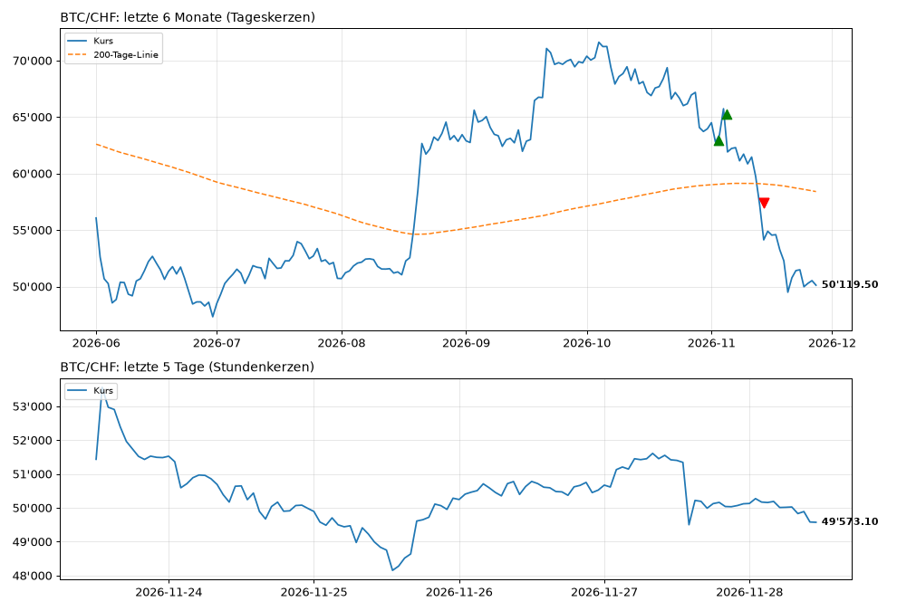
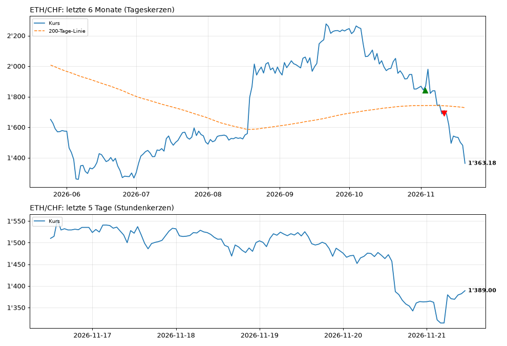
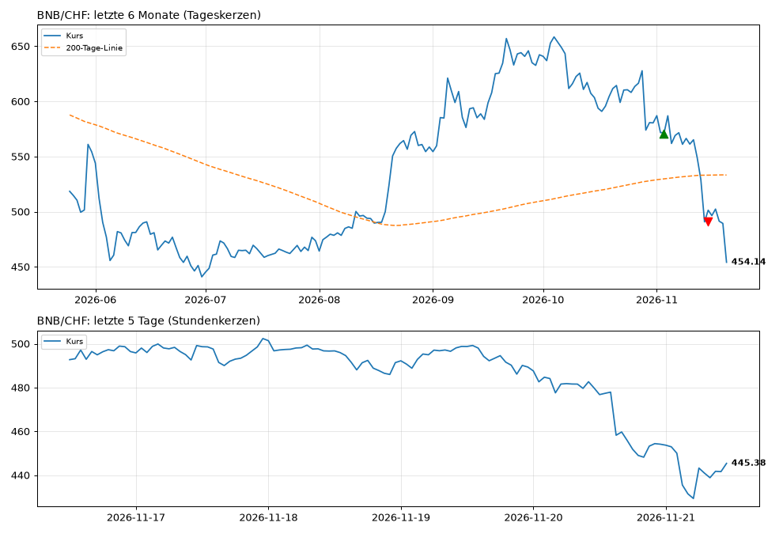
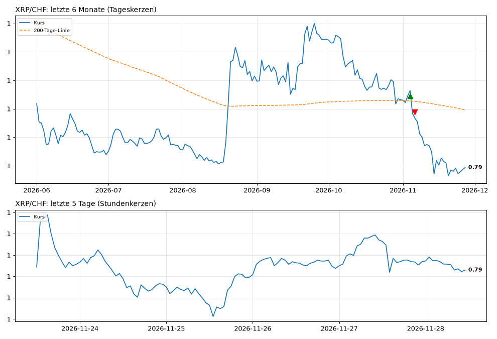
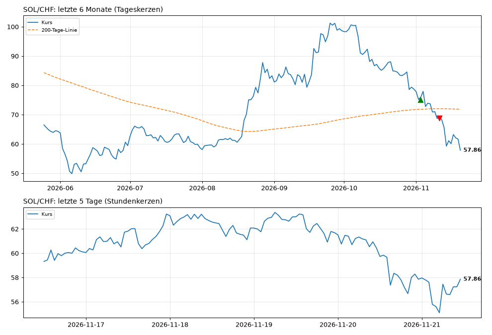
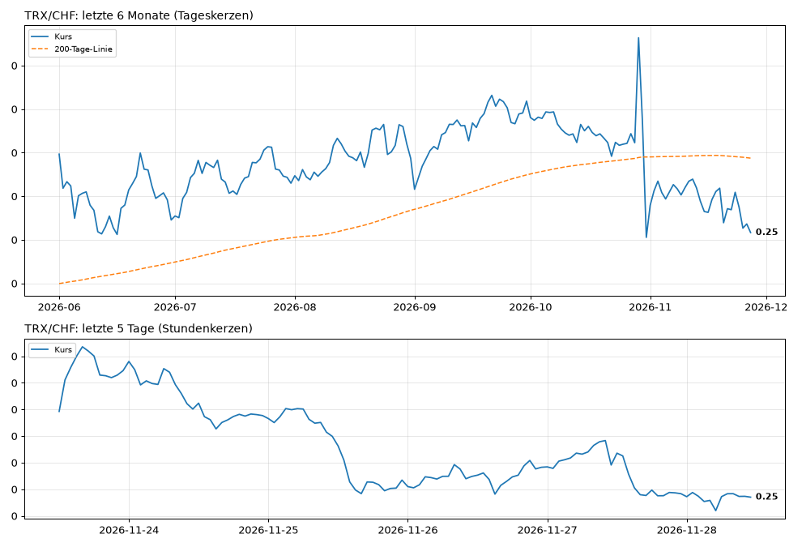
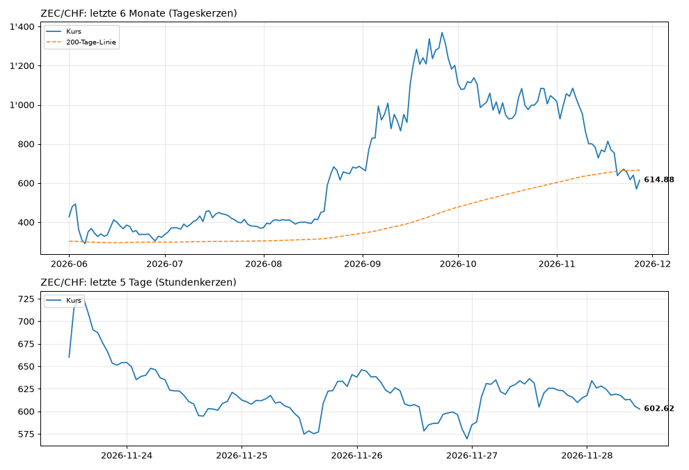
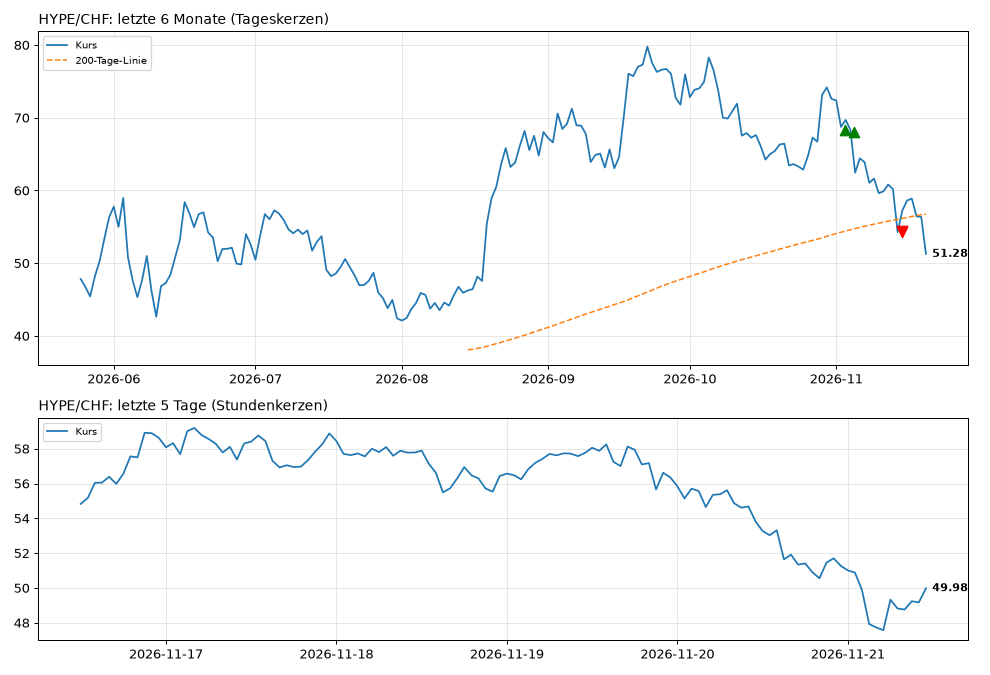

# 📈 Trading-Bot: Übersicht (Demo mit Spielgeld)

Stand: **17.11.2026 17:35** Schweizer Zeit · wird jede Stunde automatisch aktualisiert

> 🖥️ **[Zur Trading-Oberfläche](https://kaidovalue.github.io/trading-bot/)** (übersichtlich, mit Live-Chart)

## Auf einen Blick

- **1️⃣ Langfrist-Bot (Hauptbot):** Schwerpunkt langfristig (200-Tage-Linie, Wochen bis Monate), handelt auch mittelfristig (4h) und kurzfristig (1h), nur in Trendrichtung. Bis 100 % investiert, je Coin bis 20 %. Simulation 2011-2022: +58 %/Jahr, 2023-2026: +40 %/Jahr.
- **2️⃣ KI-Bot (lernend, kurz bis lang):** Lernende KI mit Gedächtnis: merkt sich für jede Marktphase, welche Strategie funktioniert, mit zeitlich abgewerteter Erfahrung. Nutzt zusätzlich selbst erfundene Strategien aus dem Strategie-Labor. Handelt auf drei Horizonten (1h Daytrading, 4h, Tageskerzen) mit je eigenem Gedächtnis, nur in Trendrichtung. Neue Lernlogik: noch keine validierte Renditeaussage. Laborstrategien erst nach separater Paper-Probe.
- **3️⃣ Risiko-Bot (aggressiv, Hebel 3×):** Risikofreudig mit Hebel 3×: 200-Tage-Linie (lang) und Trendfolge (4h), nur in Trendrichtung; Daytrading (30-Min.-Ausbrüche) seit 29.10. pausiert, weil es 64 % verlor. Simulation 2011-2022: +66 %/Jahr, 2023-2026: +59 %/Jahr, Rückgänge bis −62 %, 5 % Risiko pro Trade, Hebel 3× mit Zinsen und Zwangsschliessung wie an der Börse, ignoriert Nachrichten.
- **4️⃣ Chef-Bot:** verteilt eigene 100.00 CHF Startkapital selbstständig auf die drei Stile oben, je nachdem, was in der aktuellen Marktphase am besten läuft.

| | **1️⃣ Langfrist-Bot (Hauptbot)** | **2️⃣ KI-Bot (lernend, kurz bis lang)** | **3️⃣ Risiko-Bot (aggressiv, Hebel 3×)** |
|---|---|---|---|
| Startkapital | 100.00 CHF | 100.00 CHF | 100.00 CHF |
| **Kapital jetzt** | **95.00 CHF** | **100.00 CHF** | **84.02 CHF** |
| Gewinn / Verlust | 🔴 -5.00 CHF (-5.00 %) | ⚪ +0.00 CHF (+0.00 %) | 🔴 -15.98 CHF (-15.98 %) |
| Im Einsatz (investiert) | 0.00 CHF (0 %) | 0.00 CHF (0 %) | 0.00 CHF (0 %) |
| Cash (nicht investiert) | 95.00 CHF | 100.00 CHF | 84.02 CHF |
| Offene Positionen | 0 | 0 | 0 |
| Abgeschlossene Trades | 2 | 0 | 6 |
| Gebühren bisher | 0.45 CHF | 0.00 CHF | 2.01 CHF |
| Gebührenstufe | Stufe 1: 0.80 % je Market-Order (30-Tage-Umsatz 57 CHF) | Stufe 1: 0.80 % je Market-Order (30-Tage-Umsatz 0 CHF) | Stufe 1: 0.80 % je Market-Order (30-Tage-Umsatz 251 CHF) |
| Horizonte (Strategie, Kerzen) | lang: regime 1d · mittel: buch_triple_screen 4h · kurz: adaptive 1h | kurz: adaptive_memory 1h · mittel: adaptive_memory 4h · lang: adaptive_memory 1d | mittel: trend 4h · lang: regime 1d |
| Kapitalanteil je Horizont | lang 32 % · mittel 34 % · kurz 34 % | kurz 20 % · mittel 30 % · lang 50 % | mittel 95 % · lang 5 % |
| Short erlaubt | nein | nein | nein |
| Hebel | ohne | ohne | 3× (Zinsen bisher 0.36 CHF) |
| Hebel aktuell | – | – | 0.00× (erlaubt 3×) |
| Buchhaltung | ✅ stimmt (Abweichung 0.00 CHF) | ✅ stimmt (Abweichung 0.00 CHF) | ✅ stimmt (Abweichung 0.00 CHF) |
| Letzter Durchlauf | 17.11.2026 17:32 (vor 2 Min.) | 17.11.2026 17:33 (vor 1 Min.) | 17.11.2026 17:34 (vor 1 Min.) |

## 4️⃣ Chef-Bot (verteilt auf die drei Stile)

Er handelt nicht selbst, sondern legt sein eigenes Kapital anteilig in die Stile der drei anderen Bots an und schichtet um, wenn ein Stil in der aktuellen Marktphase besser läuft. Feste Grenzen: höchstens 20 % im Risiko-Stil (Hebel), Notbremse bei mehr als 3 % Verlust eines Stils in 3 Stunden.

| | |
|---|---|
| Startkapital | 100.00 CHF |
| **Kapital jetzt** | **94.11 CHF** |
| Gewinn / Verlust | 🔴 -5.89 CHF (-5.89 %) |
| **Aktuelle Verteilung** | Langfrist 24 % · KI 30 % · Risiko 8 % · Cash 38 % |
| Marktphase (BTC, Tageskerzen) | Abwärtstrend, wild |
| Letzte Begründung | Marktphase «Abwärtstrend, wild», Einschätzung: Langfrist -2.0 %, KI +0.0 %, Risiko -7.2 % |
| Umschicht-Gebühren bisher | 2.03 CHF |
| Erfahrung im Gedächtnis | 707 Läufe |

**Was das Gedächtnis in dieser Phase weiss:** KI +0.000 %/Lauf, Langfrist -0.005 %/Lauf, Risiko -0.021 %/Lauf

## Kurse

| Coin | Kurs jetzt | 24 Std. | Live-Chart |
|---|---|---|---|
| **BTC** | 53'581.90 CHF | 🔴 -1.71 % | [öffnen](https://www.tradingview.com/chart/?symbol=KRAKEN:BTCCHF) |
| **ETH** | 1'495.50 CHF | 🔴 -2.12 % | [öffnen](https://www.tradingview.com/chart/?symbol=KRAKEN:ETHCHF) |
| **BNB** | 491.76 CHF | 🔴 -0.80 % | [öffnen](https://www.tradingview.com/chart/?symbol=KRAKEN:BNBUSD) |
| **XRP** | 0.80 CHF | 🟢 +0.45 % | [öffnen](https://www.tradingview.com/chart/?symbol=KRAKEN:XRPUSD) |
| **SOL** | 60.72 CHF | 🟢 +1.16 % | [öffnen](https://www.tradingview.com/chart/?symbol=KRAKEN:SOLUSD) |
| **TRX** | 0.26 CHF | 🟢 +0.84 % | [öffnen](https://www.tradingview.com/chart/?symbol=KRAKEN:TRXUSD) |
| **ZEC** | 786.09 CHF | 🟢 +3.63 % | [öffnen](https://www.tradingview.com/chart/?symbol=KRAKEN:ZECUSD) |
| **HYPE** | 57.12 CHF | 🔴 -2.41 % | [öffnen](https://www.tradingview.com/chart/?symbol=KRAKEN:HYPEUSD) |

## 1️⃣ Langfrist-Bot (Hauptbot)

_Schwerpunkt langfristig (200-Tage-Linie, Wochen bis Monate), handelt auch mittelfristig (4h) und kurzfristig (1h), nur in Trendrichtung. Bis 100 % investiert, je Coin bis 20 %. Simulation 2011-2022: +58 %/Jahr, 2023-2026: +40 %/Jahr._

Keine offene Position, alles in Cash.

**Signale jetzt**

| Coin | lang (1d) | mittel (4h) | kurz (1h) |
|---|---|---|---|
| BTC | 🔴 raus / Cash | 🔴 raus / Cash | 🔴 raus / Cash |
| ETH | 🔴 raus / Cash | 🔴 raus / Cash | 🔴 raus / Cash |
| BNB | 🔴 raus / Cash | 🔴 raus / Cash | 🔴 raus / Cash |
| XRP | 🔴 raus / Cash | 🔴 raus / Cash | 🔴 raus / Cash |
| SOL | 🔴 raus / Cash | 🔴 raus / Cash | 🔴 raus / Cash |
| TRX | 🔴 raus / Cash | 🔴 raus / Cash | 🔴 raus / Cash |
| ZEC | 🟢 investiert sein | 🔴 raus / Cash | 🔴 raus / Cash |
| HYPE | 🟢 investiert sein | 🔴 raus / Cash | 🔴 raus / Cash |

**Letzte Entscheidung:** [lang] BTC/CHF: Signal 'raus', bleibe in Cash · [lang] ETH/CHF: Signal 'raus', bleibe in Cash · [lang] BNB/CHF: Signal 'raus', bleibe in Cash · [lang] XRP/CHF: Signal 'raus', bleibe in Cash · [lang] SOL/CHF: Signal 'raus', bleibe in Cash · [lang] TRX/CHF: Signal 'raus', bleibe in Cash · [lang] ZEC/CHF: Einstieg pausiert wegen Nachrichtenlage (bestätigte Themen: hack, Wert -1.00) · [lang] HYPE/CHF: Einstieg pausiert wegen Nachrichtenlage (bestätigte Themen: hack, Wert -1.00) · [mittel] BTC/CHF: Signal 'raus', bleibe in Cash · [mittel] ETH/CHF: Signal 'raus', bleibe in Cash · [mittel] BNB/CHF: Signal 'raus', bleibe in Cash · [mittel] XRP/CHF: Signal 'raus', bleibe in Cash · [mittel] SOL/CHF: Signal 'raus', bleibe in Cash · [mittel] TRX/CHF: Signal 'raus', bleibe in Cash · [mittel] ZEC/CHF: Signal 'raus', bleibe in Cash · [mittel] HYPE/CHF: Signal 'raus', bleibe in Cash · [kurz] BTC/CHF: Signal 'raus', bleibe in Cash · [kurz] ETH/CHF: Signal 'raus', bleibe in Cash · [kurz] BNB/CHF: Signal 'raus', bleibe in Cash · [kurz] XRP/CHF: Signal 'raus', bleibe in Cash · [kurz] SOL/CHF: Signal 'raus', bleibe in Cash · [kurz] TRX/CHF: Signal 'raus', bleibe in Cash · [kurz] ZEC/CHF: Signal 'raus', bleibe in Cash · [kurz] HYPE/CHF: Signal 'raus', bleibe in Cash

**Gespeicherte Entscheidungen je Coin und Horizont**

| Coin | Horizont | Geprüft (CH) | Begründung |
|---|---|---|---|
| BTC/CHF | lang | 17.11.2026 17:31 | BTC/CHF: Signal 'raus', bleibe in Cash |
| ETH/CHF | lang | 17.11.2026 17:31 | ETH/CHF: Signal 'raus', bleibe in Cash |
| BNB/CHF | lang | 17.11.2026 17:31 | BNB/CHF: Signal 'raus', bleibe in Cash |
| XRP/CHF | lang | 17.11.2026 17:31 | XRP/CHF: Signal 'raus', bleibe in Cash |
| SOL/CHF | lang | 17.11.2026 17:31 | SOL/CHF: Signal 'raus', bleibe in Cash |
| TRX/CHF | lang | 17.11.2026 17:31 | TRX/CHF: Signal 'raus', bleibe in Cash |
| ZEC/CHF | lang | 17.11.2026 17:31 | ZEC/CHF: Einstieg pausiert wegen Nachrichtenlage (bestätigte Themen: hack, Wert -1.00) |
| HYPE/CHF | lang | 17.11.2026 17:31 | HYPE/CHF: Einstieg pausiert wegen Nachrichtenlage (bestätigte Themen: hack, Wert -1.00) |
| BTC/CHF | mittel | 17.11.2026 17:31 | BTC/CHF: Signal 'raus', bleibe in Cash |
| ETH/CHF | mittel | 17.11.2026 17:31 | ETH/CHF: Signal 'raus', bleibe in Cash |
| BNB/CHF | mittel | 17.11.2026 17:31 | BNB/CHF: Signal 'raus', bleibe in Cash |
| XRP/CHF | mittel | 17.11.2026 17:31 | XRP/CHF: Signal 'raus', bleibe in Cash |
| SOL/CHF | mittel | 17.11.2026 17:31 | SOL/CHF: Signal 'raus', bleibe in Cash |
| TRX/CHF | mittel | 17.11.2026 17:31 | TRX/CHF: Signal 'raus', bleibe in Cash |
| ZEC/CHF | mittel | 17.11.2026 17:31 | ZEC/CHF: Signal 'raus', bleibe in Cash |
| HYPE/CHF | mittel | 17.11.2026 17:31 | HYPE/CHF: Signal 'raus', bleibe in Cash |
| BTC/CHF | kurz | 17.11.2026 17:31 | BTC/CHF: Signal 'raus', bleibe in Cash · KI: Keine simulierten Ausführungen: Filter, Kapital und Mindestorder prüfen |
| ETH/CHF | kurz | 17.11.2026 17:31 | ETH/CHF: Signal 'raus', bleibe in Cash · KI: Keine simulierten Ausführungen: Filter, Kapital und Mindestorder prüfen |
| BNB/CHF | kurz | 17.11.2026 17:31 | BNB/CHF: Signal 'raus', bleibe in Cash · KI: Keine simulierten Ausführungen: Filter, Kapital und Mindestorder prüfen |
| XRP/CHF | kurz | 17.11.2026 17:31 | XRP/CHF: Signal 'raus', bleibe in Cash · KI: Keine simulierten Ausführungen: Filter, Kapital und Mindestorder prüfen |
| SOL/CHF | kurz | 17.11.2026 17:31 | SOL/CHF: Signal 'raus', bleibe in Cash · KI: Keine simulierten Ausführungen: Filter, Kapital und Mindestorder prüfen |
| TRX/CHF | kurz | 17.11.2026 17:31 | TRX/CHF: Signal 'raus', bleibe in Cash · KI: Keine simulierten Ausführungen: Filter, Kapital und Mindestorder prüfen |
| ZEC/CHF | kurz | 17.11.2026 17:31 | ZEC/CHF: Signal 'raus', bleibe in Cash · KI: Keine simulierten Ausführungen: Filter, Kapital und Mindestorder prüfen |
| HYPE/CHF | kurz | 17.11.2026 17:31 | HYPE/CHF: Signal 'raus', bleibe in Cash · KI: Keine simulierten Ausführungen: Filter, Kapital und Mindestorder prüfen |

**Letzte abgeschlossene Trades**

| Coin | Gekauft | Verkauft | Einstieg | Ausstieg | Ergebnis | Grund |
|---|---|---|---|---|---|---|
| HYPE long (lang) | 04.11.2026 21:01 | 15.11.2026 01:01 | 68.01 | 54.26 | 🔴 -2.29 CHF | Signal |
| BTC long (lang) | 04.11.2026 21:01 | 14.11.2026 01:01 | 65'280.50 | 57'405.90 | 🔴 -2.71 CHF | Signal |

## 2️⃣ KI-Bot (lernend, kurz bis lang)

_Lernende KI mit Gedächtnis: merkt sich für jede Marktphase, welche Strategie funktioniert, mit zeitlich abgewerteter Erfahrung. Nutzt zusätzlich selbst erfundene Strategien aus dem Strategie-Labor. Handelt auf drei Horizonten (1h Daytrading, 4h, Tageskerzen) mit je eigenem Gedächtnis, nur in Trendrichtung. Neue Lernlogik: noch keine validierte Renditeaussage. Laborstrategien erst nach separater Paper-Probe._

Keine offene Position, alles in Cash.

**Signale jetzt**

| Coin | kurz (1h) | mittel (4h) | lang (1d) |
|---|---|---|---|
| BTC | 🔴 raus / Cash | 🔴 raus / Cash | 🔴 raus / Cash |
| ETH | 🔴 raus / Cash | 🔴 raus / Cash | 🔴 raus / Cash |
| BNB | 🔴 raus / Cash | 🔴 raus / Cash | 🔴 raus / Cash |
| XRP | 🔴 raus / Cash | 🔴 raus / Cash | 🔴 raus / Cash |
| SOL | 🔴 raus / Cash | 🔴 raus / Cash | 🔴 raus / Cash |
| TRX | 🔴 raus / Cash | 🔴 raus / Cash | 🔴 raus / Cash |
| ZEC | 🔴 raus / Cash | 🔴 raus / Cash | 🔴 raus / Cash |
| HYPE | 🔴 raus / Cash | 🔴 raus / Cash | 🔴 raus / Cash |

**🧠 KI-Gedächtnis:** 5'054 Kerzen Erfahrung (zeitlich gewichtete Kerzen; ältere Erfahrung zählt weniger)

| Coin | Marktphase jetzt | Hier vertraut die KI am meisten |
|---|---|---|
| BTC | Abwärtstrend, ruhig | trend (+0.000 %/Kerze), mean_reversion (+0.000 %/Kerze), breakout (+0.000 %/Kerze) |
| ETH | Abwärtstrend, wild | trend (+0.000 %/Kerze), mean_reversion (+0.000 %/Kerze), breakout (+0.000 %/Kerze) |
| BNB | Abwärtstrend, ruhig | trend (+0.000 %/Kerze), mean_reversion (+0.000 %/Kerze), breakout (+0.000 %/Kerze) |
| XRP | Abwärtstrend, ruhig | trend (+0.000 %/Kerze), mean_reversion (+0.000 %/Kerze), breakout (+0.000 %/Kerze) |
| SOL | Abwärtstrend, ruhig | trend (+0.000 %/Kerze), mean_reversion (+0.000 %/Kerze), breakout (+0.000 %/Kerze) |
| TRX | Seitwärts, ruhig | trend (+0.000 %/Kerze), mean_reversion (+0.000 %/Kerze), breakout (+0.000 %/Kerze) |
| ZEC | Aufwärtstrend, ruhig | trend (+0.000 %/Kerze), mean_reversion (+0.000 %/Kerze), breakout (+0.000 %/Kerze) |
| HYPE | Seitwärts, ruhig | trend (+0.000 %/Kerze), mean_reversion (+0.000 %/Kerze), breakout (+0.000 %/Kerze) |

**🧪 Selbst erfundene Strategien im Einsatz:** 0 (noch keine hat die Prüfung bestanden), Details in [lernen/LABOR.md](lernen/LABOR.md)

**Letzte Entscheidung:** [kurz] BTC/CHF: Signal 'raus', bleibe in Cash · [kurz] ETH/CHF: Signal 'raus', bleibe in Cash · [kurz] BNB/CHF: Signal 'raus', bleibe in Cash · [kurz] XRP/CHF: Signal 'raus', bleibe in Cash · [kurz] SOL/CHF: Signal 'raus', bleibe in Cash · [kurz] TRX/CHF: Signal 'raus', bleibe in Cash · [kurz] ZEC/CHF: Signal 'raus', bleibe in Cash · [kurz] HYPE/CHF: Signal 'raus', bleibe in Cash · [mittel] BTC/CHF: Signal 'raus', bleibe in Cash · [mittel] ETH/CHF: Signal 'raus', bleibe in Cash · [mittel] BNB/CHF: Signal 'raus', bleibe in Cash · [mittel] XRP/CHF: Signal 'raus', bleibe in Cash · [mittel] SOL/CHF: Signal 'raus', bleibe in Cash · [mittel] TRX/CHF: Signal 'raus', bleibe in Cash · [mittel] ZEC/CHF: Signal 'raus', bleibe in Cash · [mittel] HYPE/CHF: Signal 'raus', bleibe in Cash

**Gespeicherte Entscheidungen je Coin und Horizont**

| Coin | Horizont | Geprüft (CH) | Begründung |
|---|---|---|---|
| BTC/CHF | kurz | 17.11.2026 17:02 | BTC/CHF: Signal 'raus', bleibe in Cash · KI: Keine simulierten Ausführungen: Filter, Kapital und Mindestorder prüfen |
| ETH/CHF | kurz | 17.11.2026 17:02 | ETH/CHF: Signal 'raus', bleibe in Cash · KI: Keine simulierten Ausführungen: Filter, Kapital und Mindestorder prüfen |
| BNB/CHF | kurz | 17.11.2026 17:02 | BNB/CHF: Signal 'raus', bleibe in Cash · KI: Keine simulierten Ausführungen: Filter, Kapital und Mindestorder prüfen |
| XRP/CHF | kurz | 17.11.2026 17:02 | XRP/CHF: Signal 'raus', bleibe in Cash · KI: Keine simulierten Ausführungen: Filter, Kapital und Mindestorder prüfen |
| SOL/CHF | kurz | 17.11.2026 17:02 | SOL/CHF: Signal 'raus', bleibe in Cash · KI: Keine simulierten Ausführungen: Filter, Kapital und Mindestorder prüfen |
| TRX/CHF | kurz | 17.11.2026 17:02 | TRX/CHF: Signal 'raus', bleibe in Cash · KI: Keine simulierten Ausführungen: Filter, Kapital und Mindestorder prüfen |
| ZEC/CHF | kurz | 17.11.2026 17:02 | ZEC/CHF: Signal 'raus', bleibe in Cash · KI: Keine simulierten Ausführungen: Filter, Kapital und Mindestorder prüfen |
| HYPE/CHF | kurz | 17.11.2026 17:02 | HYPE/CHF: Signal 'raus', bleibe in Cash · KI: Keine simulierten Ausführungen: Filter, Kapital und Mindestorder prüfen |
| BTC/CHF | mittel | 17.11.2026 17:02 | BTC/CHF: Signal 'raus', bleibe in Cash · KI: Keine simulierten Ausführungen: Filter, Kapital und Mindestorder prüfen |
| ETH/CHF | mittel | 17.11.2026 17:02 | ETH/CHF: Signal 'raus', bleibe in Cash · KI: Keine simulierten Ausführungen: Filter, Kapital und Mindestorder prüfen |
| BNB/CHF | mittel | 17.11.2026 17:02 | BNB/CHF: Signal 'raus', bleibe in Cash · KI: Keine simulierten Ausführungen: Filter, Kapital und Mindestorder prüfen |
| XRP/CHF | mittel | 17.11.2026 17:02 | XRP/CHF: Signal 'raus', bleibe in Cash · KI: Keine simulierten Ausführungen: Filter, Kapital und Mindestorder prüfen |
| SOL/CHF | mittel | 17.11.2026 17:02 | SOL/CHF: Signal 'raus', bleibe in Cash · KI: Keine simulierten Ausführungen: Filter, Kapital und Mindestorder prüfen |
| TRX/CHF | mittel | 17.11.2026 17:02 | TRX/CHF: Signal 'raus', bleibe in Cash · KI: Keine simulierten Ausführungen: Filter, Kapital und Mindestorder prüfen |
| ZEC/CHF | mittel | 17.11.2026 17:02 | ZEC/CHF: Signal 'raus', bleibe in Cash · KI: Keine simulierten Ausführungen: Filter, Kapital und Mindestorder prüfen |
| HYPE/CHF | mittel | 17.11.2026 17:02 | HYPE/CHF: Signal 'raus', bleibe in Cash · KI: Keine simulierten Ausführungen: Filter, Kapital und Mindestorder prüfen |
| BTC/CHF | lang | 17.11.2026 01:02 | BTC/CHF: Signal 'raus', bleibe in Cash · KI: 6/9 Strategien positiv gewichtet |
| ETH/CHF | lang | 17.11.2026 01:02 | ETH/CHF: Signal 'raus', bleibe in Cash · KI: 2/9 Strategien positiv gewichtet |
| BNB/CHF | lang | 17.11.2026 01:02 | BNB/CHF: Signal 'raus', bleibe in Cash · KI: 4/9 Strategien positiv gewichtet |
| XRP/CHF | lang | 17.11.2026 01:02 | XRP/CHF: Signal 'raus', bleibe in Cash · KI: Keine positiv gewichtete Strategie nach Kosten |
| SOL/CHF | lang | 17.11.2026 01:02 | SOL/CHF: Signal 'raus', bleibe in Cash · KI: 5/9 Strategien positiv gewichtet |
| TRX/CHF | lang | 17.11.2026 01:02 | TRX/CHF: Signal 'raus', bleibe in Cash · KI: 1/9 Strategien positiv gewichtet |
| ZEC/CHF | lang | 17.11.2026 01:02 | ZEC/CHF: Signal 'raus', bleibe in Cash · KI: 2/9 Strategien positiv gewichtet |
| HYPE/CHF | lang | 17.11.2026 01:02 | HYPE/CHF: Signal 'raus', bleibe in Cash · KI: Keine positiv gewichtete Strategie nach Kosten |

**KI-Forschung: getrennte Vorwärtstests mit Kosten**

Die Werte betreffen isolierte Testpositionen, keine erzielte Portfoliorendite.

| Horizont | Status | Ausgewertet | Offen | Datenlücken / ungültig |
|---|---|---|---|---|
| kurz | Sammelt Lernfälle | 381 | 8 | 0 |
| mittel | Sammelt Lernfälle | 75 | 8 | 0 |
| lang | Sammelt Lernfälle | 9 | 8 | 0 |

## 3️⃣ Risiko-Bot (aggressiv, Hebel 3×)

_Risikofreudig mit Hebel 3×: 200-Tage-Linie (lang) und Trendfolge (4h), nur in Trendrichtung; Daytrading (30-Min.-Ausbrüche) seit 29.10. pausiert, weil es 64 % verlor. Simulation 2011-2022: +66 %/Jahr, 2023-2026: +59 %/Jahr, Rückgänge bis −62 %, 5 % Risiko pro Trade, Hebel 3× mit Zinsen und Zwangsschliessung wie an der Börse, ignoriert Nachrichten._

Keine offene Position, alles in Cash.

**Signale jetzt**

| Coin | mittel (4h) | lang (1d) |
|---|---|---|
| BTC | 🔴 raus / Cash | 🔴 raus / Cash |
| ETH | 🔴 raus / Cash | 🔴 raus / Cash |
| BNB | 🔴 raus / Cash | 🔴 raus / Cash |
| XRP | 🔴 raus / Cash | 🔴 raus / Cash |
| SOL | 🔴 raus / Cash | 🔴 raus / Cash |
| TRX | 🔴 raus / Cash | 🔴 raus / Cash |
| ZEC | 🔴 raus / Cash | 🟢 investiert sein |
| HYPE | 🔴 raus / Cash | 🟢 investiert sein |

**Letzte Entscheidung:** [mittel] BTC/CHF: Signal 'raus', bleibe in Cash · [mittel] ETH/CHF: Signal 'raus', bleibe in Cash · [mittel] BNB/CHF: Signal 'raus', bleibe in Cash · [mittel] XRP/CHF: Signal 'raus', bleibe in Cash · [mittel] SOL/CHF: Signal 'raus', bleibe in Cash · [mittel] TRX/CHF: Signal 'raus', bleibe in Cash · [mittel] ZEC/CHF: Signal 'raus', bleibe in Cash · [mittel] HYPE/CHF: Signal 'raus', bleibe in Cash

**Gespeicherte Entscheidungen je Coin und Horizont**

| Coin | Horizont | Geprüft (CH) | Begründung |
|---|---|---|---|
| BTC/CHF | mittel | 17.11.2026 17:04 | BTC/CHF: Signal 'raus', bleibe in Cash |
| ETH/CHF | mittel | 17.11.2026 17:04 | ETH/CHF: Signal 'raus', bleibe in Cash |
| BNB/CHF | mittel | 17.11.2026 17:04 | BNB/CHF: Signal 'raus', bleibe in Cash |
| XRP/CHF | mittel | 17.11.2026 17:04 | XRP/CHF: Signal 'raus', bleibe in Cash |
| SOL/CHF | mittel | 17.11.2026 17:04 | SOL/CHF: Signal 'raus', bleibe in Cash |
| TRX/CHF | mittel | 17.11.2026 17:04 | TRX/CHF: Signal 'raus', bleibe in Cash |
| ZEC/CHF | mittel | 17.11.2026 17:04 | ZEC/CHF: Signal 'raus', bleibe in Cash |
| HYPE/CHF | mittel | 17.11.2026 17:04 | HYPE/CHF: Signal 'raus', bleibe in Cash |
| BTC/CHF | lang | 17.11.2026 01:04 | BTC/CHF: Signal 'raus', bleibe in Cash |
| ETH/CHF | lang | 17.11.2026 01:04 | ETH/CHF: Signal 'raus', bleibe in Cash |
| BNB/CHF | lang | 17.11.2026 01:04 | BNB/CHF: Signal 'raus', bleibe in Cash |
| XRP/CHF | lang | 17.11.2026 01:04 | XRP/CHF: Signal 'raus', bleibe in Cash |
| SOL/CHF | lang | 17.11.2026 01:04 | SOL/CHF: Signal 'raus', bleibe in Cash |
| TRX/CHF | lang | 17.11.2026 01:04 | TRX/CHF: Signal 'raus', bleibe in Cash |
| ZEC/CHF | lang | 17.11.2026 01:04 | ZEC/CHF: kein Einstieg (Order kleiner als Mindestgrösse) |
| HYPE/CHF | lang | 17.11.2026 01:04 | HYPE/CHF: kein Einstieg (Order kleiner als Mindestgrösse) |

**Letzte abgeschlossene Trades**

| Coin | Gekauft | Verkauft | Einstieg | Ausstieg | Ergebnis | Grund |
|---|---|---|---|---|---|---|
| HYPE long (lang) | 02.11.2026 21:04 | 15.11.2026 01:04 | 68.38 | 54.43 | 🔴 -3.45 CHF | Signal |
| BNB long (lang) | 02.11.2026 21:04 | 15.11.2026 01:04 | 570.38 | 491.18 | 🔴 -3.66 CHF | Signal |
| BTC long (lang) | 02.11.2026 21:04 | 14.11.2026 01:04 | 62'905.40 | 57'418.20 | 🔴 -3.37 CHF | Signal |
| SOL long (lang) | 02.11.2026 21:04 | 11.11.2026 01:04 | 75.10 | 68.79 | 🔴 -1.74 CHF | Signal |
| ETH long (lang) | 02.11.2026 21:04 | 11.11.2026 01:04 | 1'843.99 | 1'692.30 | 🔴 -2.28 CHF | Signal |
| XRP long (lang) | 04.11.2026 01:04 | 06.11.2026 01:04 | 1.05 | 0.99 | 🔴 -1.49 CHF | Signal |

## Charts

▲ grün = Kauf, ▼ rot = Verkauf, rote Linie = Stop-Loss, orange = 200-Tage-Linie. Die Bilder zeigen den Stand der letzten Aktualisierung; für den Live-Kurs auf «Live-Chart» klicken.

### BTC/CHF · [Live-Chart](https://www.tradingview.com/chart/?symbol=KRAKEN:BTCCHF)

### ETH/CHF · [Live-Chart](https://www.tradingview.com/chart/?symbol=KRAKEN:ETHCHF)

### BNB/CHF · [Live-Chart](https://www.tradingview.com/chart/?symbol=KRAKEN:BNBUSD)

### XRP/CHF · [Live-Chart](https://www.tradingview.com/chart/?symbol=KRAKEN:XRPUSD)

### SOL/CHF · [Live-Chart](https://www.tradingview.com/chart/?symbol=KRAKEN:SOLUSD)

### TRX/CHF · [Live-Chart](https://www.tradingview.com/chart/?symbol=KRAKEN:TRXUSD)

### ZEC/CHF · [Live-Chart](https://www.tradingview.com/chart/?symbol=KRAKEN:ZECUSD)

### HYPE/CHF · [Live-Chart](https://www.tradingview.com/chart/?symbol=KRAKEN:HYPEUSD)

## Nachrichtenlage

**Zusätzliche Sprachanalyse:** Sprachanalyse ausgeschaltet

- **Stimmung (Fear & Greed):** 12 von 100, extreme Angst
- **Bewertung News:** -1.00 (−1 sehr negativ bis +1 sehr positiv)
- **Bestätigte Themen:** hack (gemeldet von coindesk, cointelegraph – blockiert Käufe)

**Schlagzeilen dazu:**

- 2026-11-17 10:22 UTC · **coindesk** · [Hackers plant crypto-stealing code on 178 major websites, including HSBC and Ledger](https://www.coindesk.com/tech/2026/11/17/hackers-planted-crypto-stealing-code-on-178-organizations-sites-including-hsbc-bbc-and-ledger) _(Thema: hack)_
- 2026-11-17 01:02 UTC · **cointelegraph** · [Hackers inject credit card, crypto-stealing malware into 178 major websites](https://cointelegraph.com/news/hackers-inject-malware-into-178-major-websites?utm_source=rss_feed&utm_medium=rss&utm_campaign=rss_partner_inbound) _(Thema: hack)_
- 2026-11-16 16:41 UTC · **coindesk** · [Lighter suspends all withdrawals after $10.4 million crypto exploit](https://www.coindesk.com/tech/2026/11/16/lighter-suspends-all-withdrawals-after-usd10-4-million-crypto-exploit) _(Thema: hack)_
