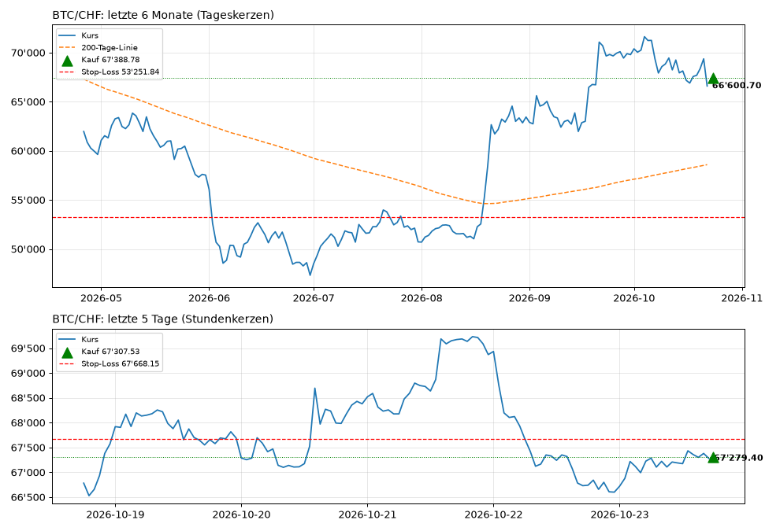
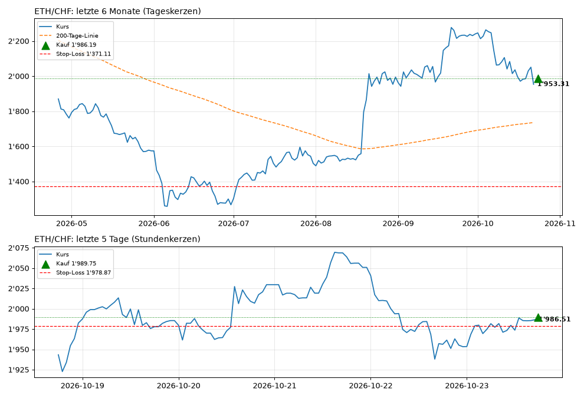
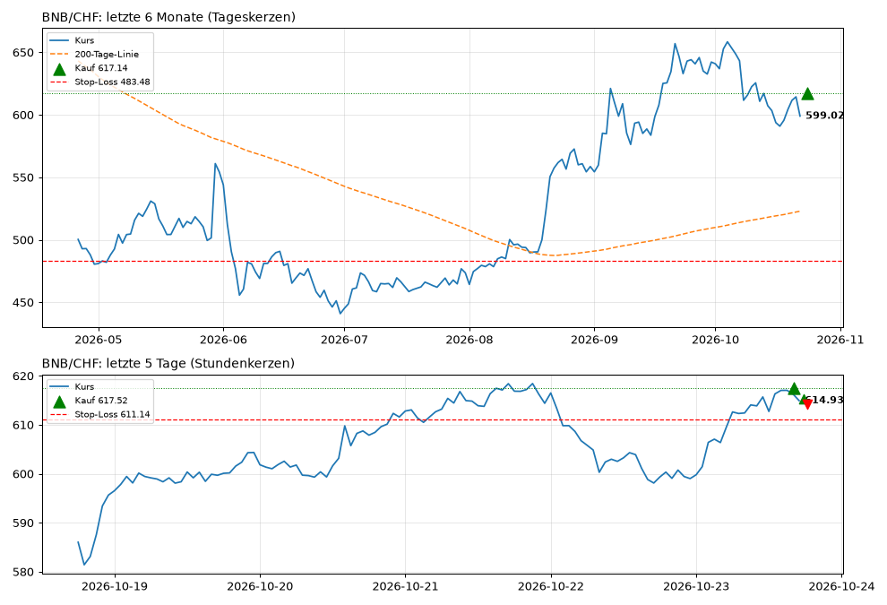
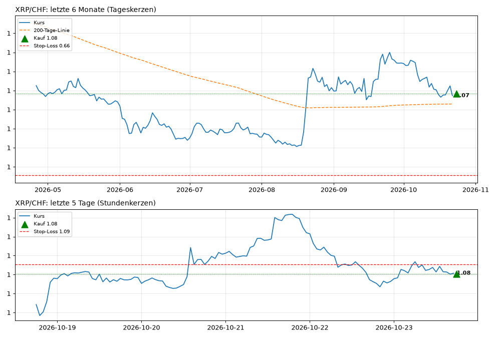
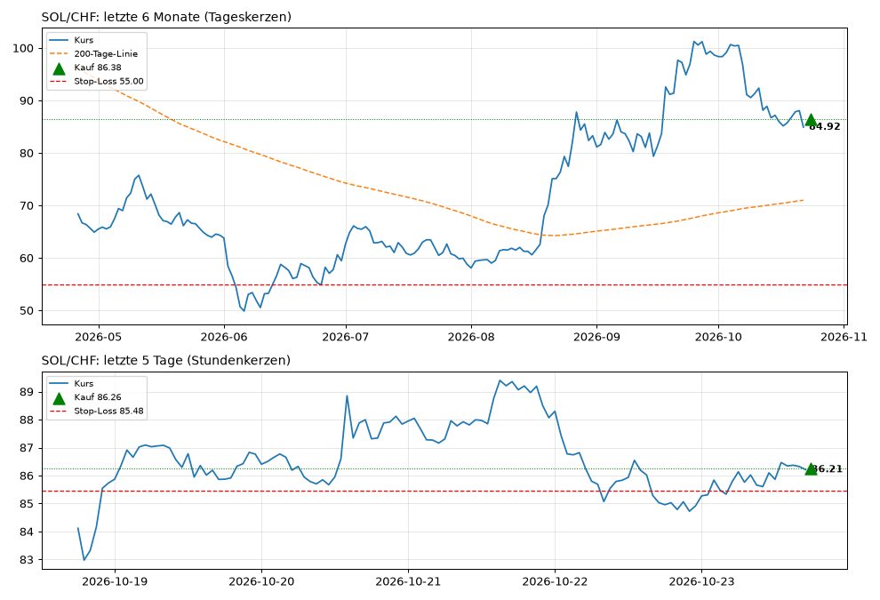
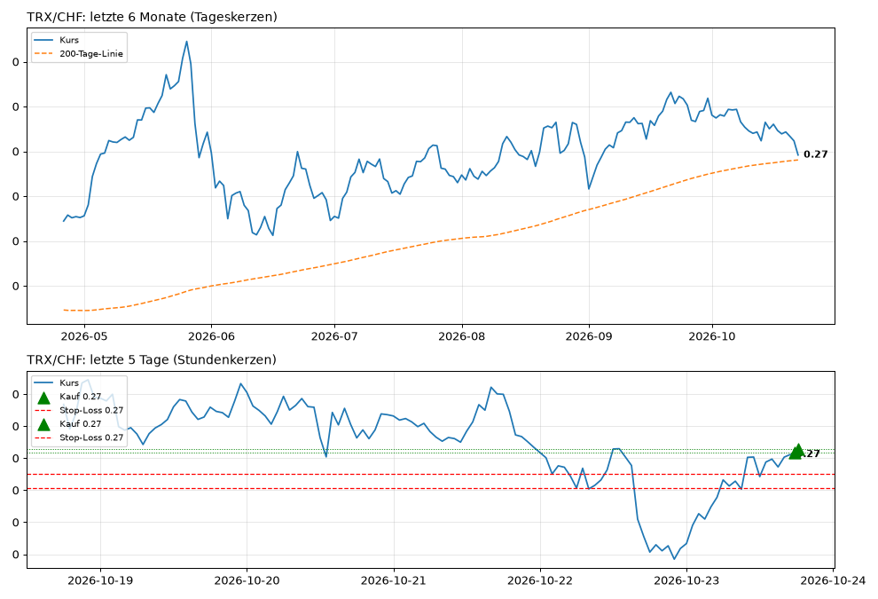
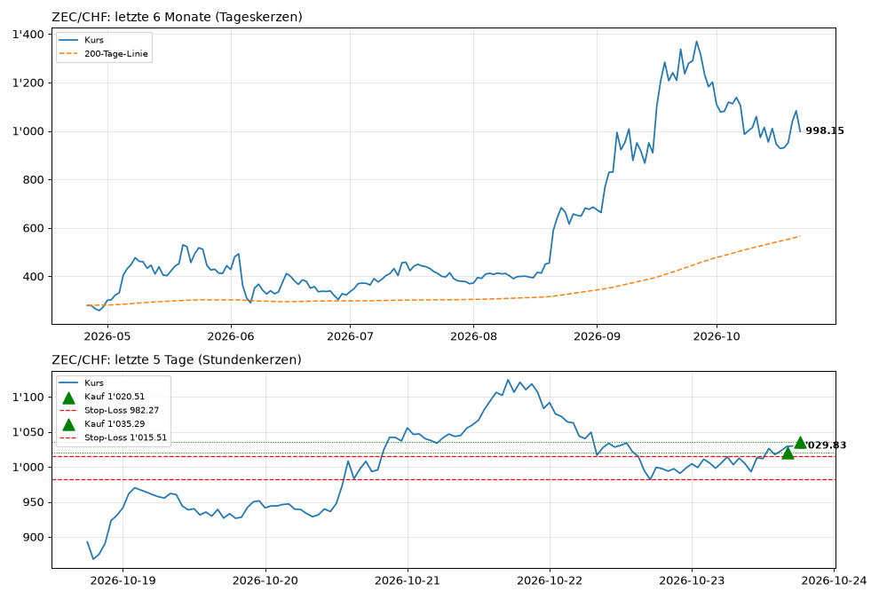
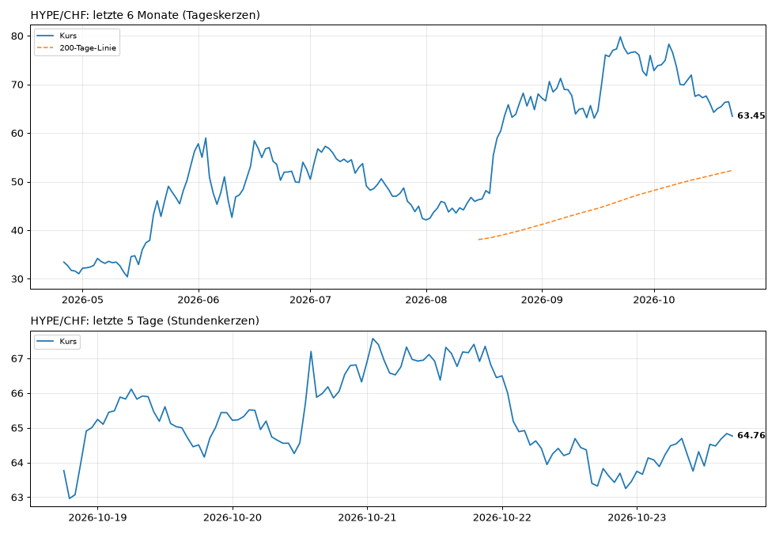

# 📈 Trading-Bot: Übersicht (Demo mit Spielgeld)

Stand: **23.10.2026 20:18** Schweizer Zeit · wird jede Stunde automatisch aktualisiert

## Auf einen Blick

- **1️⃣ Langfrist-Bot (Hauptbot):** Hält Coins über Wochen bis Monate, solange der Kurs über der 200-Tage-Linie liegt. Wenige Trades, max. 50 % investiert.
- **2️⃣ KI-Bot (lernend, Daytrading):** Lernende KI mit Gedächtnis: merkt sich für jede Marktphase, welche Strategie funktioniert, und vergisst nichts. Nutzt zusätzlich selbst erfundene Strategien aus dem Strategie-Labor. 1-Stunden-Kerzen, Positionen meist Stunden bis 1–2 Tage.
- **3️⃣ Risiko-Bot (aggressiv, Hebel 3×):** Sehr risikofreudig: viele Trades alle 30 Minuten, setzt auch auf fallende Kurse (Short), 5 % Risiko pro Trade, Hebel 3× mit Zinsen und Zwangsschliessung wie an der Börse, ignoriert Nachrichten.

| | **1️⃣ Langfrist-Bot (Hauptbot)** | **2️⃣ KI-Bot (lernend, Daytrading)** | **3️⃣ Risiko-Bot (aggressiv, Hebel 3×)** |
|---|---|---|---|
| Startkapital | 1'000.00 CHF | 1'000.00 CHF | 1'000.00 CHF |
| **Kapital jetzt** | **997.56 CHF** | **997.99 CHF** | **978.40 CHF** |
| Gewinn / Verlust | 🔴 -2.44 CHF (-0.24 %) | 🔴 -2.01 CHF (-0.20 %) | 🔴 -21.60 CHF (-2.16 %) |
| Im Einsatz (investiert) | 412.60 CHF (41 %) | 752.19 CHF (75 %) | 2'952.75 CHF (302 %) |
| Cash (nicht investiert) | 584.96 CHF | 245.80 CHF | 65.79 CHF |
| Offene Positionen | 5 | 3 | 6 |
| Abgeschlossene Trades | 0 | 0 | 1 |
| Strategie | regime, 1d-Kerzen | adaptive_memory, 1h-Kerzen | breakout, 30m-Kerzen |
| Hebel | ohne | ohne | 3× (Zinsen bisher 0.03 CHF) |

## Kurse

| Coin | Kurs jetzt | 24 Std. | Live-Chart |
|---|---|---|---|
| **BTC** | 67'235.30 CHF | 🟢 +0.89 % | [öffnen](https://www.tradingview.com/chart/?symbol=KRAKEN:BTCCHF) |
| **ETH** | 1'987.31 CHF | 🟢 +1.79 % | [öffnen](https://www.tradingview.com/chart/?symbol=KRAKEN:ETHCHF) |
| **BNB** | 614.49 CHF | 🟢 +1.86 % | [öffnen](https://www.tradingview.com/chart/?symbol=KRAKEN:BNBUSD) |
| **XRP** | 1.08 CHF | 🟢 +0.30 % | [öffnen](https://www.tradingview.com/chart/?symbol=KRAKEN:XRPUSD) |
| **SOL** | 86.13 CHF | 🟢 +0.71 % | [öffnen](https://www.tradingview.com/chart/?symbol=KRAKEN:SOLUSD) |
| **TRX** | 0.27 CHF | 🟢 +0.38 % | [öffnen](https://www.tradingview.com/chart/?symbol=KRAKEN:TRXUSD) |
| **ZEC** | 1'033.78 CHF | 🟢 +2.66 % | [öffnen](https://www.tradingview.com/chart/?symbol=KRAKEN:ZECUSD) |
| **HYPE** | 64.60 CHF | 🟢 +1.11 % | [öffnen](https://www.tradingview.com/chart/?symbol=KRAKEN:HYPEUSD) |

## 1️⃣ Langfrist-Bot (Hauptbot)

_Hält Coins über Wochen bis Monate, solange der Kurs über der 200-Tage-Linie liegt. Wenige Trades, max. 50 % investiert._

**Offene Positionen**

| Coin | Gekauft am | Einstiegskurs | Kurs jetzt | Menge | Einsatz | Wert jetzt | Gewinn / Verlust | Stop-Loss |
|---|---|---|---|---|---|---|---|---|
| **BTC** long | 23.10.2026 18:09 | 67'388.78 | 67'235.30 | 0.001485 | 100.05 CHF | 99.82 CHF | 🔴 -0.23 CHF (-0.23 %) | 53'251.84 (-21 %) |
| **ETH** long | 23.10.2026 18:09 | 1'986.19 | 1'987.31 | 0.040710 | 80.86 CHF | 80.90 CHF | 🟢 +0.05 CHF (+0.06 %) | 1'371.11 (-31 %) |
| **BNB** long | 23.10.2026 19:15 | 617.14 | 614.49 | 0.162070 | 100.02 CHF | 99.59 CHF | 🔴 -0.43 CHF (-0.43 %) | 483.48 (-21 %) |
| **XRP** long | 23.10.2026 19:15 | 1.08 | 1.08 | 58.690975 | 63.53 CHF | 63.57 CHF | 🟢 +0.04 CHF (+0.07 %) | 0.66 (-39 %) |
| **SOL** long | 23.10.2026 19:15 | 86.38 | 86.13 | 0.797780 | 68.91 CHF | 68.71 CHF | 🔴 -0.20 CHF (-0.28 %) | 55.00 (-36 %) |

**Signale jetzt**

| Coin | Signal |
|---|---|
| BTC | 🟢 investiert sein |
| ETH | 🟢 investiert sein |
| BNB | 🟢 investiert sein |
| XRP | 🟢 investiert sein |
| SOL | 🟢 investiert sein |
| TRX | ⚪ neutral |
| ZEC | 🟢 investiert sein |
| HYPE | 🟢 investiert sein |

**Letzte Entscheidung:** BTC/CHF: Position offen, Signal bestätigt · ETH/CHF: Position offen, Signal bestätigt · BNB/CHF: Position offen, Signal bestätigt · XRP/CHF: Position offen, Signal bestätigt · SOL/CHF: Position offen, Signal bestätigt · TRX/CHF: kein Signal · ZEC/CHF: kein Einstieg (max. offene Positionen) · HYPE/CHF: kein Einstieg (max. offene Positionen)

## 2️⃣ KI-Bot (lernend, Daytrading)

_Lernende KI mit Gedächtnis: merkt sich für jede Marktphase, welche Strategie funktioniert, und vergisst nichts. Nutzt zusätzlich selbst erfundene Strategien aus dem Strategie-Labor. 1-Stunden-Kerzen, Positionen meist Stunden bis 1–2 Tage._

**Offene Positionen**

| Coin | Gekauft am | Einstiegskurs | Kurs jetzt | Menge | Einsatz | Wert jetzt | Gewinn / Verlust | Stop-Loss |
|---|---|---|---|---|---|---|---|---|
| **BNB** long | 23.10.2026 18:10 | 617.52 | 614.49 | 0.405049 | 250.12 CHF | 248.90 CHF | 🔴 -1.23 CHF (-0.49 %) | 611.14 (-1 %) |
| **ZEC** long | 23.10.2026 18:10 | 1'020.51 | 1'033.78 | 0.245099 | 250.12 CHF | 253.38 CHF | 🟢 +3.25 CHF (+1.30 %) | 982.27 (-5 %) |
| **TRX** long | 23.10.2026 20:16 | 0.27 | 0.27 | 918.327343 | 250.05 CHF | 249.92 CHF | 🔴 -0.13 CHF (-0.05 %) | 0.27 (-0 %) |

**Signale jetzt**

| Coin | Signal |
|---|---|
| BTC | 🔴 raus / Cash |
| ETH | 🔴 raus / Cash |
| BNB | 🟢 investiert sein |
| XRP | 🔴 raus / Cash |
| SOL | 🔴 raus / Cash |
| TRX | 🟢 investiert sein |
| ZEC | 🟢 investiert sein |
| HYPE | 🔴 raus / Cash |

**🧠 KI-Gedächtnis:** 19'910 Kerzen Erfahrung (wächst bei jedem Lauf)

| Coin | Marktphase jetzt | Hier vertraut die KI am meisten |
|---|---|---|
| BTC | Seitwärts, wild | mean_reversion (+0.033 %/Kerze), labor_2 (+0.006 %/Kerze), labor_1 (+0.006 %/Kerze) |
| ETH | Seitwärts, wild | mean_reversion (+0.033 %/Kerze), labor_2 (+0.006 %/Kerze), labor_1 (+0.006 %/Kerze) |
| BNB | Aufwärtstrend, wild | trend (+0.071 %/Kerze), momentum (+0.064 %/Kerze), reversal (+0.055 %/Kerze) |
| XRP | Abwärtstrend, ruhig | trend (-0.008 %/Kerze), pullback (-0.010 %/Kerze), labor_4 (-0.011 %/Kerze) |
| SOL | Seitwärts, ruhig | mean_reversion (+0.014 %/Kerze), labor_4 (+0.003 %/Kerze), labor_3 (+0.002 %/Kerze) |
| TRX | Seitwärts, wild | mean_reversion (+0.033 %/Kerze), labor_2 (+0.006 %/Kerze), labor_1 (+0.006 %/Kerze) |
| ZEC | Aufwärtstrend, wild | trend (+0.071 %/Kerze), momentum (+0.064 %/Kerze), reversal (+0.055 %/Kerze) |
| HYPE | Seitwärts, ruhig | mean_reversion (+0.014 %/Kerze), labor_4 (+0.003 %/Kerze), labor_3 (+0.002 %/Kerze) |

**🧪 Selbst erfundene Strategien im Einsatz:** 4 (labor_3, labor_4, labor_2, labor_1), Details in [lernen/LABOR.md](lernen/LABOR.md)

**Letzte Entscheidung:** BTC/CHF: Signal 'raus', bleibe in Cash · ETH/CHF: Signal 'raus', bleibe in Cash · BNB/CHF: Position offen, Signal bestätigt · XRP/CHF: Signal 'raus', bleibe in Cash · SOL/CHF: Signal 'raus', bleibe in Cash · TRX/CHF: gekauft 918.327343 @ 0.27 · ZEC/CHF: Position offen, Signal bestätigt · HYPE/CHF: Signal 'raus', bleibe in Cash

## 3️⃣ Risiko-Bot (aggressiv, Hebel 3×)

_Sehr risikofreudig: viele Trades alle 30 Minuten, setzt auch auf fallende Kurse (Short), 5 % Risiko pro Trade, Hebel 3× mit Zinsen und Zwangsschliessung wie an der Börse, ignoriert Nachrichten._

**Offene Positionen**

| Coin | Gekauft am | Einstiegskurs | Kurs jetzt | Menge | Einsatz | Wert jetzt | Gewinn / Verlust | Stop-Loss |
|---|---|---|---|---|---|---|---|---|
| **BTC** short | 23.10.2026 19:46 | 67'307.53 | 67'235.30 | 0.007573 | 509.75 CHF | 509.20 CHF | 🟢 +0.55 CHF (+0.11 %) | 67'668.15 (+1 %) |
| **ETH** long | 23.10.2026 19:46 | 1'989.75 | 1'987.31 | 0.256441 | 510.25 CHF | 509.63 CHF | 🔴 -0.63 CHF (-0.12 %) | 1'978.87 (-0 %) |
| **XRP** short | 23.10.2026 19:46 | 1.08 | 1.08 | 471.664724 | 509.75 CHF | 510.88 CHF | 🔴 -1.13 CHF (-0.22 %) | 1.09 (+1 %) |
| **SOL** long | 23.10.2026 19:46 | 86.26 | 86.13 | 5.915396 | 510.25 CHF | 509.49 CHF | 🔴 -0.76 CHF (-0.15 %) | 85.48 (-1 %) |
| **TRX** long | 23.10.2026 19:46 | 0.27 | 0.27 | 1653.266901 | 449.97 CHF | 449.93 CHF | 🔴 -0.04 CHF (-0.01 %) | 0.27 (-0 %) |
| **ZEC** long | 23.10.2026 20:17 | 1'035.29 | 1'033.78 | 0.448483 | 464.31 CHF | 463.63 CHF | 🔴 -0.68 CHF (-0.15 %) | 1'015.51 (-2 %) |

**Signale jetzt**

| Coin | Signal |
|---|---|
| BTC | 🔴 raus / Cash |
| ETH | 🟢 investiert sein |
| BNB | 🔴 raus / Cash |
| XRP | 🔴 raus / Cash |
| SOL | 🟢 investiert sein |
| TRX | 🟢 investiert sein |
| ZEC | 🟢 investiert sein |
| HYPE | 🟢 investiert sein |

**Letzte Entscheidung:** BTC/CHF: Position offen, Signal bestätigt · ETH/CHF: Position offen, Signal bestätigt · BNB/CHF: kein Einstieg (Order kleiner als Mindestgrösse) · XRP/CHF: Position offen, Signal bestätigt · SOL/CHF: Position offen, Signal bestätigt · TRX/CHF: Position offen, Signal bestätigt · ZEC/CHF: gekauft 0.448483 @ 1035.29 · HYPE/CHF: kein Einstieg (max. offene Positionen)

**Letzte abgeschlossene Trades**

| Coin | Gekauft | Verkauft | Einstieg | Ausstieg | Ergebnis | Grund |
|---|---|---|---|---|---|---|
| BNB long | 23.10.2026 19:46 | 23.10.2026 20:17 | 615.23 | 614.18 | 🔴 -3.52 CHF | Signal |

## Charts

▲ grün = Kauf, ▼ rot = Verkauf, rote Linie = Stop-Loss, orange = 200-Tage-Linie. Die Bilder zeigen den Stand der letzten Aktualisierung; für den Live-Kurs auf «Live-Chart» klicken.

### BTC/CHF · [Live-Chart](https://www.tradingview.com/chart/?symbol=KRAKEN:BTCCHF)

### ETH/CHF · [Live-Chart](https://www.tradingview.com/chart/?symbol=KRAKEN:ETHCHF)

### BNB/CHF · [Live-Chart](https://www.tradingview.com/chart/?symbol=KRAKEN:BNBUSD)

### XRP/CHF · [Live-Chart](https://www.tradingview.com/chart/?symbol=KRAKEN:XRPUSD)

### SOL/CHF · [Live-Chart](https://www.tradingview.com/chart/?symbol=KRAKEN:SOLUSD)

### TRX/CHF · [Live-Chart](https://www.tradingview.com/chart/?symbol=KRAKEN:TRXUSD)

### ZEC/CHF · [Live-Chart](https://www.tradingview.com/chart/?symbol=KRAKEN:ZECUSD)

### HYPE/CHF · [Live-Chart](https://www.tradingview.com/chart/?symbol=KRAKEN:HYPEUSD)

## Nachrichtenlage

- **Stimmung (Fear & Greed):** 50 von 100, neutral
- **Bewertung News:** -0.30 (−1 sehr negativ bis +1 sehr positiv)
- **Bestätigte Themen:** klage (gemeldet von bitcoinmagazine, cointelegraph – nur Hinweis, blockiert nicht)

**Schlagzeilen dazu:**

- 2026-10-22 21:39 UTC · **cointelegraph** · [Circle shareholder sues Trump, World Liberty and Steve Witkoff over crypto deals](https://cointelegraph.com/news/circle-shareholder-lawsuit-donald-trump-world-liberty-financial-steve-witkoff-crypto-corruption?utm_source=rss_feed&utm_medium=rss&utm_campaign=rss_partner_inbound) _(Thema: klage)_
- 2026-10-22 21:23 UTC · **bitcoinmagazine** · [Circle Shareholder Sues Trump, Alleging Unconstitutional Profits From $2B UAE Crypto Deals](https://bitcoinmagazine.com/news/trump-sued-for-alleged-crypto-corruption) _(Thema: klage)_
